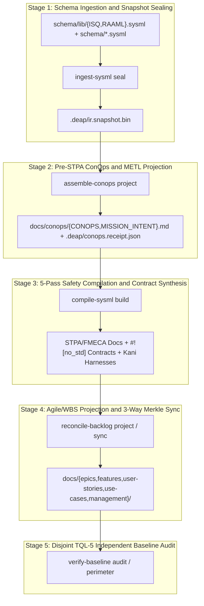

# DEAP-avionic-flight-safety -- Avionic Flight Safety Parent Template

> **Repository Role:** `DOMAIN_DISTRIBUTION_TEMPLATE` (`--perimeter-role downstream-consumer`)
> **Upstream Toolchain Baseline:** `gintatkinson/deap03@e75d23d412fa88f5ecc9683c0615c3303d43bf00` (`stage-10-complete`, Ferrocene `stable-26.08.0`)
> **Primary Technology Profiles:** `MATLAB / Simulink / Stateflow / Embedded Coder` | `ROS2 C++ Real-Time` | `Target Embedded Platform Execution Profile`
> **Target Regulatory Frameworks:** `DO-178C / DO-331` | `ARP4754B / ARP4761A` | `JARUS SORA v2.5 (SAIL I-VI)` | `ASTM F3269-17 RTA` | `RTCA DO-365B DAA`

---

## 1. System Overview

This repository is the **Avionic Flight Safety Parent Template** governed by the **Digital Engineering Agent Platform (`deap03`)** for airborne flight control assurance, run-time assurance (RTA) simplex architectures, envelope protection, and DO-178C / DO-331 model-based design.

### 1.1 Clean Landing Zone, Preserved Domain Corpus & Zero-Source Perimeter Invariant

As a **Downstream Domain Distribution Template** (`--perimeter-role downstream-consumer`), this repository enforces strict zero-source isolation (`N_up_src == 0`, zero upstream `crates/deap-*` sources, zero upstream `blueprints/*.md`, and zero symbolic links):

- Foundation SysML v2 / ISO 80000 ISQ and OMG RAAML v1.0 libraries reside strictly in `schema/lib/ISQ.sysml` and `schema/lib/RAAML.sysml` (`--schema-scope lib-only`).
- Authoritative avionic flight safety domain catalogs and scoping documents are preserved under `docs/`:
  - `docs/catalogs/FLIGHT_SAFETY_CONTROL_PATTERN_CATALOG.md`
  - `docs/catalogs/STANDARDS_OBLIGATION_CATALOG.md`
  - `docs/domain/DOMAIN_SCOPE.md`
  - `docs/domain/SYNTHESIS_RESIDUALS.md`
  - `docs/research/RESEARCH_INVENTORY.md`
  - `docs/OPERATOR_PROMPT_CATALOG.md`
- Specification landing zones (`docs/conops/`, `docs/epics/`, `docs/features/`, `docs/interfaces/`, `docs/management/`, `docs/safety/`, `docs/use-cases/`, `docs/user-stories/`) remain clean landing zones with `.gitkeep`.
- Concrete customer aircraft/UAS schemas (`schema/*.sysml`), generated flight contracts, Simulink `.slx` models, and flight software belong exclusively in downstream customer application workspaces cloned from this template.

### 1.2 Primary Commercial Toolchain Integration Context

This platform explicitly declares **MATLAB / Simulink / Stateflow / Embedded Coder** as the Primary Tier-1 Commercial Toolchain Integration Context (Model-Based Design, Control Law Synthesis, DO-178C C / SPARK Ada code generation), governed by [CLAUDE.md](./CLAUDE.md) and [NON_RUST_MULTI_TOOLCHAIN_PROFILES.md](./downstream-profiles/profile-non-rust-targets/NON_RUST_MULTI_TOOLCHAIN_PROFILES.md).

---

## 2. Workspace Structure, Foundation Libraries & Downstream Profiles

- `.deap/bin/`: Five precompiled, `Ed25519`-attested Ferrocene `stable-26.08.0` native binaries (`ingest-sysml`, `assemble-conops`, `compile-sysml`, `reconcile-backlog`, `verify-baseline`).
- `.deap/update-manifest.json`: Signed `0x60` RFC 8785 JCS release manifest (SHA-256 `1243abcb151f276806ea96b01e77b671e3eed03b4c8e1653fa5bd5baee8b3619`) verified under Tier-2 public key `VK_REL = 606a0547d9928339c7c8f8dc7cd075969390fa8fb3497b3702013b9074d6d54b`.
- `criticalup.toml`: Pinned Ferrocene `stable-26.08.0` qualified Rust toolchain manifest.
- `schema/lib/`: Normative foundation libraries (`ISQ.sysml`, `RAAML.sysml`) validated by `verify-baseline perimeter --schema-scope lib-only`.
- `downstream-profiles/`: Self-contained Downstream Profile Export Bundle:
  - [downstream-profiles/README.md](./downstream-profiles/README.md) & [DOWNSTREAM_INSTALLATION_AND_CI_GUIDE.md](./downstream-profiles/DOWNSTREAM_INSTALLATION_AND_CI_GUIDE.md)
  - `profile-non-rust-targets/`: MATLAB/Simulink/Stateflow/Embedded Coder, ANSYS SCADE KCG & ARINC 661, SPARK 2014, MISRA C/C++, SAE AS5506D AADL, and OpenModelica FMI 2.0/3.0 profiles
  - `profile-dart-flutter-hmi/`: Ring-3 Dart/Flutter coding standard, safety-critical real-time UI blueprint, Dart-Rust FFI synthesis profile, and C11 `include/deap_ffi.h`
  - `profile-target-app-runtime/`: Dynamic runtime metadata engine and zero-ephemeral SQLite persistence blueprints
- `.gitlab-ci.yml`: Two-lane downstream CI pipeline (`deap-perimeter:macos-arm64` and `deap-airlock:linux`).
- `AGENTS.md` & `CLAUDE.md`: Project-scoped agent governance rules, Simulink Tier-1 declaration, and verification gates.
- `docs/`: Avionic flight safety catalogs (`docs/catalogs/`), domain scoping (`docs/domain/`), research inventory (`docs/research/`), `docs/OPERATOR_PROMPT_CATALOG.md`, and clean specification landing zones.

---

## 3. Signed `deap03` `B_5` Native Toolchain (`stage-10-complete`)

The repository ships the five-binary `B_5` release tuple built from `gintatkinson/deap03@e75d23d412fa88f5ecc9683c0615c3303d43bf00` under strict generator/verifier module disjointness:

| Binary Path | Assurance Qualification | Architectural Role & Subcommands | `aarch64-apple-darwin` SHA-256 |
| :--- | :--- | :--- | :--- |
| `./.deap/bin/ingest-sysml` | `DO-330 TQL-1` | Deterministic SysML v2 / Markdown / legacy DEAP01 frontend and canonical `.deap/ir.snapshot.bin` sealer (`check`, `seal`, `slice`, `migrate-legacy`). | `547423a6ce5519c27c05a0bbdda8c7f3cd50c41550c85cbedcf37bde872dccd4` |
| `./.deap/bin/assemble-conops` | `DO-330 TQL-1` | Pre-STPA ConOps and METL operational slice assembler synthesizing `CONOPS.md`, `MISSION_INTENT.md`, and `.deap/conops.receipt.json` (`check`, `project`, `slice`). | `95dcc3811aaef022c8830414453bf2fcb08a6438134efc70177dd7d4f634ab2d` |
| `./.deap/bin/compile-sysml` | `DO-330 TQL-1` / `ISO 26262 TCL3` | 5-pass safety compiler, ZBDD minimal cut-set analyzer, `#![no_std]` contract synthesizer, and Tier-A Rust docstring injector (`check`, `build`, `supersede-seed`, `inject-docstrings`). | `67d66d74e6ccc2aa1500cb8de2c5ae93acc75981e7b18b4665bbf8c3b5f34ccf` |
| `./.deap/bin/reconcile-backlog` | `DO-330 TQL-1` | Stage P4/P5/M3.5 Agile/WBS Markdown projector and 3-way Merkle tracker reconciler (`project`, `sync`, `tracker`, `slice`, `migrate-defects`). | `c8dc68869c86806be3929c731add49bd47ced182349f9ab91b2c7653c7dda0a1` |
| `./.deap/bin/verify-baseline` | `DO-330 TQL-5` | Disjoint independent baseline oracle, `0x60` `UpdateManifest` verifier, atomic `B_5` bundle installer, and downstream perimeter gate (`audit`, `hygiene`, `attest`, `verify-manifest`, `install-bundle`, `perimeter`, `setup-hooks`). | `e93cbd9fc426243b4a0fe2e975012f8b43199d5d6027bd3fc6cfda18679743ab` |

---

## 4. Downstream Verification, Bundle Upgrade & Pipeline Workflows

### 4.1 Mandatory Local Verification Gates (Quick Start)

Verify the detached `Ed25519` release manifest signature, all five `B_5` binary digests, zero-source perimeter isolation (`N_up_src == 0`), zero symlinks, pure 7-bit LF ASCII, and `ISQ`/`RAAML` foundation lowering:

```sh
# 1. Verify signed 0x60 UpdateManifest and all 5 B_5 binaries
./.deap/bin/verify-baseline verify-manifest \
  --workspace . \
  --manifest .deap/update-manifest.json \
  --bundle-dir .deap/bin \
  --verify-key 606a0547d9928339c7c8f8dc7cd075969390fa8fb3497b3702013b9074d6d54b

# 2. Run snapshot-free downstream perimeter, ASCII, and ISQ/RAAML gate
./.deap/bin/verify-baseline perimeter \
  --workspace . \
  --perimeter-role downstream-consumer \
  --schema-scope lib-only \
  --manifest .deap/update-manifest.json \
  --bundle-dir .deap/bin \
  --verify-key 606a0547d9928339c7c8f8dc7cd075969390fa8fb3497b3702013b9074d6d54b
```

### 4.2 Atomic `B_5` Bundle Upgrade & Deterministic Git Hooks

```sh
# Install deterministic 0o755 POSIX pre-commit and pre-push Git hooks
./.deap/bin/verify-baseline setup-hooks --workspace .

# Atomically stage and activate an upgraded signed B_5 bundle with .prev rollback safety
./.deap/bin/verify-baseline install-bundle \
  --workspace . \
  --perimeter-role downstream-consumer \
  --bundle-dir /path/to/stage10-release-bundle/aarch64-apple-darwin \
  --manifest /path/to/stage10-release-bundle/update-manifest.json \
  --verify-key 606a0547d9928339c7c8f8dc7cd075969390fa8fb3497b3702013b9074d6d54b \
  --install-dir .deap/bin
```

### 4.3 End-to-End 5-Stage `deap03` Specification & Synthesis Pipeline



In populated customer flight-safety workspaces cloned from this template, execute the five pipeline stages in order:

```sh
# Stage 1: Seal canonical SysML v2 + RAAML v1 IR snapshot (or lift brownfield Markdown via --format markdown --from-docs)
./.deap/bin/ingest-sysml seal --workspace . --schema-dir schema --out-snapshot .deap/ir.snapshot.bin

# Stage 2: Project deterministic CONOPS.md, MISSION_INTENT.md, and R_conops receipt
./.deap/bin/assemble-conops project --workspace . --snapshot .deap/ir.snapshot.bin --out-dir docs/conops

# Stage 3: Run 5-pass safety compiler and emit modular #![no_std] Rust contracts + Kani harnesses
./.deap/bin/compile-sysml build \
  --workspace . \
  --snapshot .deap/ir.snapshot.bin \
  --conops-receipt .deap/conops.receipt.json \
  --out-docs docs \
  --out-contracts crates/flight-core/src/generated \
  --out-kani crates/flight-core/src/kani_generated \
  --emit-modular-rust crates/flight-core/src/deap_modular

# Stage 4: Project Agile/WBS specifications and run 3-way Merkle tracker reconciliation
./.deap/bin/reconcile-backlog project --workspace . --snapshot .deap/ir.snapshot.bin --docs-dir docs
./.deap/bin/reconcile-backlog sync --workspace . --snapshot .deap/ir.snapshot.bin --docs-dir docs --schema-dir schema --provider offline

# Stage 5: Run full TQL-5 independent baseline audit across populated domain artifacts
./.deap/bin/verify-baseline audit --workspace . --schema-dir schema --docs-dir docs --snapshot .deap/ir.snapshot.bin
```

### 4.4 Multi-Provider Backlog Reconciliation Commands

```sh
# Option A: Offline Air-Gapped / Deterministic Local Store (.deap/offline-tracker.json)
./.deap/bin/reconcile-backlog sync --workspace . --provider offline

# Option B: GitHub Issues Reconciliation
./.deap/bin/reconcile-backlog sync --workspace . --provider github --project "<owner>/<repo>" --token "$GITHUB_TOKEN"

# Option C: GitLab SaaS or Self-Managed SCIF Air-Gapped Reconciliation
./.deap/bin/reconcile-backlog sync \
  --workspace . \
  --provider gitlab \
  --endpoint "https://gitlab.internal.example/api/v4" \
  --project "<group>/<repo>" \
  --ca-bundle /path/to/ca-bundle.pem \
  --token "$GITLAB_TOKEN"
```

---

## 5. Avionic Flight Safety & Two-Path (Dual-Track) MBD Synthesis Architecture

### 5.1 Two-Path (Dual-Track) Simulink / Embedded Coder & Rust Digital Twin Hierarchy

Every avionic flight-safety feature containing inner-loop control laws, flight envelope protection monitors, simplex RTA switching logic, or state estimators delivers the canonical two-path MBD artifact suite governed by [NON_RUST_MULTI_TOOLCHAIN_PROFILES.md](./downstream-profiles/profile-non-rust-targets/NON_RUST_MULTI_TOOLCHAIN_PROFILES.md):

```text
models/
+-- scripts/
|   +-- build_<feature_slug>_model.m        # Track A: Programmatic Simulink/Stateflow builder script
+-- matlab/
|   +-- <feature_slug>_params.m             # Track A: MATLAB physical plant & control parameters
|   +-- <feature_slug>_data.sldd            # Track A: Simulink Data Dictionary (data types & signals)
+-- rust_twin/
    +-- <feature_slug>_domain.rs            # Track B: Strongly-typed domain models & state vectors
    +-- <feature_slug>_engine.rs            # Track B: Standalone discrete-time simulation engine

docs/reports/simulink_results/
+-- <FEATURE-ID>_simulation_results.md      # Formal DO-331 simulation & numerical parity report
```

1. **Track A (`models/scripts/build_<feature_slug>_model.m` + `.sldd`)**: Programmatically constructs native MATLAB / Simulink (`.slx`) block diagrams and Stateflow charts configured for deterministic fixed-step discrete solvers (`FixedStepDiscrete`, $dt = 0.004\,\text{s}$ / 250 Hz) and Embedded Coder DO-178C C / SPARK Ada code synthesis.
2. **Track B (`models/rust_twin/`)**: License-free headless discrete Rust digital twin executing identical algebraic formulations and safety transition guards in containerized CI (`cargo test --workspace`) with infinity-norm trajectory equivalence $\|x_{\mathrm{Simulink}} - x_{\mathrm{DigitalTwin}}\|_\infty \le 10^{-6}$.
3. **Formal DO-331 Verification Report (`docs/reports/simulink_results/<FEATURE-ID>_simulation_results.md`)**: Documents MC/DC coverage mapping, state transition truth tables, fault-injection logs, and Track A/B numerical parity.

### 5.2 Ring-3 Avionic Station & Ground Control HMI (`app_flutter/`)

Ground station and flight test instrumentation HMIs reside strictly under `app_flutter/` and follow [DART_FLUTTER_CODING_STANDARD.md](./downstream-profiles/profile-dart-flutter-hmi/DART_FLUTTER_CODING_STANDARD.md), [SAFETY_CRITICAL_REALTIME_UI_BLUEPRINT.md](./downstream-profiles/profile-dart-flutter-hmi/SAFETY_CRITICAL_REALTIME_UI_BLUEPRINT.md), and [DART_RUST_FFI_SYNTHESIS_PROFILE.md](./downstream-profiles/profile-dart-flutter-hmi/DART_RUST_FFI_SYNTHESIS_PROFILE.md).
