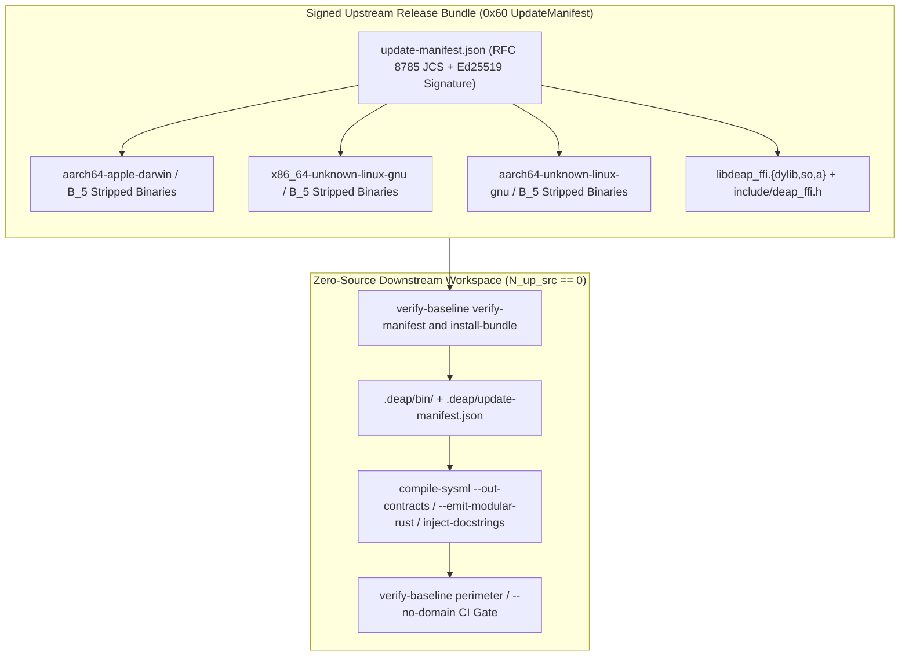

# DEAP Downstream Bundle Installation, C-ABI FFI & Multi-Arch CI Runbook

| Attribute | Specification Detail |
| :--- | :--- |
| **Document Identifier** | `DEAP-DOWNSTREAM-INSTALL-CI-001` |
| **Version** | `2.2.0` |
| **Status** | `APPROVED / PRODUCTION RUNBOOK` |
| **Parent Export Manifest** | [README.md](./README.md) |
| **Companion HMI FFI Profile** | [DART_RUST_FFI_SYNTHESIS_PROFILE.md](./profile-dart-flutter-hmi/DART_RUST_FFI_SYNTHESIS_PROFILE.md) |
| **Canonical C11 Header** | [deap_ffi.h](./profile-dart-flutter-hmi/include/deap_ffi.h) |

---

## 1. Scope & Zero-Source Perimeter Invariants

Downstream platform templates (`UPSTREAM_PLATFORM_TEMPLATE`) and mission repositories
(`DOWNSTREAM_CUSTOMER_PROJECT`) consume the precompiled, `Ed25519`-attested five-binary `B_5`
release bundle (`ingest-sysml`, `assemble-conops`, `compile-sysml`, `reconcile-backlog`,
`verify-baseline`) and optional Ring-2 `libdeap_ffi` shared/static libraries without copying
upstream compiler crates (`N_up_src == 0`) or upstream `blueprints/*.md` files.



---

## 2. Atomic `B_5` Bundle Verification & Installation

1. **Verify Detached `0x60` Manifest & Payload Digests Before Activation**:

```sh
verify-baseline verify-manifest \
  --workspace . \
  --manifest /path/to/release-bundle/update-manifest.json \
  --bundle-dir /path/to/release-bundle \
  --verify-key "$DEAP_RELEASE_PUBKEY_HEX"
```

2. **Atomically Stage & Activate `.deap/bin/*` + `.deap/update-manifest.json`**:

```sh
verify-baseline install-bundle \
  --workspace . \
  --perimeter-role downstream-consumer \
  --bundle-dir /path/to/release-bundle \
  --manifest /path/to/release-bundle/update-manifest.json \
  --verify-key "$DEAP_RELEASE_PUBKEY_HEX" \
  --install-dir .deap/bin \
  --target aarch64-apple-darwin
```

3. **Mark Native Binaries in `.gitattributes`**:
   Ensure `.deap/bin/** binary` is present in `.gitattributes` so Git never alters Mach-O or ELF
   executable bytes across checkouts.

---

## 3. Customer Monorepo Synthesis & Legacy Migration Workflows

### 3.1 Custom Contract Paths, Modular `#![no_std]` Rust & Tier-A Docstring Injection

- **Custom Customer Crate Output Paths (`Delta_drift == 0`)**:

```sh
./.deap/bin/compile-sysml build \
  --workspace . \
  --out-contracts crates/mission-core/src/generated \
  --out-kani crates/mission-core/src/kani_generated \
  --emit-modular-rust crates/mission-core/src/deap_modular
```

  `compile-sysml` rejects colliding `--out-contracts` and `--out-kani` directories fail-closed
  (`DEAP_E0104`, exit `10`) and records all normalized workspace-relative paths inside
  `.deap/compile.receipt.json` (`0x30`).

- **AST-Driven Tier-A Docstring Injection (`syn` + `prettyplease`, Zero Regex)**:

```sh
./.deap/bin/compile-sysml inject-docstrings \
  --workspace . \
  --target-dir crates/mission-core/src \
  --ir-in .deap/ir.snapshot.bin
```

### 3.2 Brownfield Markdown & Legacy DEAP01 `.sysml` Non-Destructive Lift

- **Non-Destructive Legacy DEAP01 Migration**:

```sh
./.deap/bin/ingest-sysml migrate-legacy \
  --workspace . \
  --from legacy_models \
  --out schema
```

- **Direct Format-Aware Check / Seal (`sysml`, `markdown`, `deap01`)**:

```sh
./.deap/bin/ingest-sysml seal \
  --workspace . \
  --format markdown \
  --from-docs docs/requirements \
  --schema-dir schema
```

---

## 4. Ring-2 C-ABI Shared/Static Library (`libdeap_ffi`) & `deap_ffi.h`

The standalone `ffi/` workspace compiles into `libdeap_ffi.rlib`, `libdeap_ffi.dylib` (macOS) /
`libdeap_ffi.so` (Linux), and `libdeap_ffi.a` under `#![forbid(unsafe_code)]`:

```sh
CARGO_TARGET_DIR="$PWD/target/ffi-release" \
  criticalup run cargo build --manifest-path ffi/Cargo.toml --release --offline
```

Downstream C, C++, and Dart `dart:ffi` hosts include
[deap_ffi.h](./profile-dart-flutter-hmi/include/deap_ffi.h) (`MAX_FFI_SLICE_BYTES = 4096`):

- `deap_ffi_verify_bundle`: Verifies `0x60` `UpdateManifest` JCS + `Ed25519` signature + all five
  `B_5` binary `SHA-256` digests (`out_meta->byte_len == 5` on `DEAP_FFI_STATUS_OK`).
- `deap_ffi_run_stage`: Enforces `N_up_src == 0` via `WorkspaceSandboxGuard`, verifies
  `.deap/update-manifest.json` and `.deap/bin/<stage>` prior to direct-argv spawn (`stage_id`
  `0..=4`), and writes canonical `BridgeOutcome` RFC 8785 JCS JSON into `FfiFixedBuffer`.

---

## 5. Multi-Architecture Ferrocene `26.08.0` CI Runner Matrix

### 5.1 Upstream Multi-Target Release Build & Signing Matrix (GitHub Actions)

```yaml
name: deap-multiarch-release-bundle
on:
  workflow_dispatch:
jobs:
  build-b5-tuple:
    strategy:
      fail-fast: true
      matrix:
        include:
          - target: x86_64-unknown-linux-gnu
            os: ubuntu-24.04
            strip_flag: "-C link-arg=-Wl,--build-id=none"
          - target: aarch64-unknown-linux-gnu
            os: ubuntu-24.04-arm
            strip_flag: "-C link-arg=-Wl,--build-id=none"
          - target: aarch64-apple-darwin
            os: macos-15
            strip_flag: "-C link-arg=-Wl,-S"
    runs-on: ${{ matrix.os }}
    steps:
      - uses: actions/checkout@v4
      - name: Install Pinned Ferrocene 26.08.0 via criticalup
        run: criticalup install
      - name: Build Deterministic B_5 Release Binaries and libdeap_ffi
        env:
          ZERO_AR_DATE: "1"
        run: |
          criticalup run cargo build --workspace --bins --release --offline \
            --target "${{ matrix.target }}"
          CARGO_TARGET_DIR="$PWD/target/ffi" \
            criticalup run cargo build --manifest-path ffi/Cargo.toml \
            --release --offline --target "${{ matrix.target }}"
```

### 5.2 Downstream Two-Lane `.gitlab-ci.yml` Verification Template

```yaml
stages:
  - deap-verify

deap-perimeter:macos-arm64:
  stage: deap-verify
  tags: [macos, arm64]
  script:
    - ./.deap/bin/verify-baseline verify-manifest
        --workspace .
        --manifest .deap/update-manifest.json
        --bundle-dir .deap/bin
        --verify-key "$DEAP_RELEASE_PUBKEY"
    - ./.deap/bin/verify-baseline perimeter
        --workspace .
        --perimeter-role downstream-consumer
        --verify-key "$DEAP_RELEASE_PUBKEY"

deap-perimeter:linux-x86_64:
  stage: deap-verify
  tags: [linux, x86_64]
  script:
    - test ! -d blueprints && test ! -d crates/deap-verify-core
    - if [ -x ./.deap/bin/x86_64-unknown-linux-gnu/verify-baseline ]; then
        ./.deap/bin/x86_64-unknown-linux-gnu/verify-baseline perimeter
          --workspace .
          --perimeter-role downstream-consumer
          --verify-key "$DEAP_RELEASE_PUBKEY";
      fi
```
