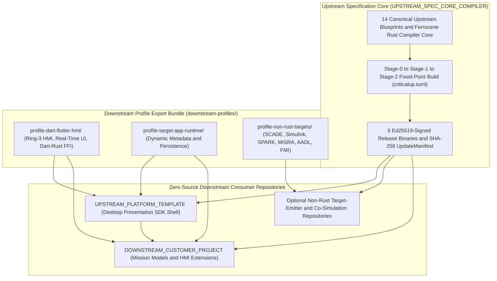

# DEAP Downstream Profile Export Bundle Manifest

| Attribute | Specification Detail |
| :--- | :--- |
| **Bundle Identifier** | `DEAP-DOWNSTREAM-PROFILES-MANIFEST` |
| **Version** | `2.1.0` |
| **Status** | `APPROVED / NORMATIVE EXPORT BUNDLE` |
| **Source Authority** | `UPSTREAM_SPEC_CORE_COMPILER` (Ferrocene Qualified Rust Toolchain pinned via `criticalup.toml`) |
| **Downstream Consumers** | `UPSTREAM_PLATFORM_TEMPLATE`, Optional Target-Emitter Repositories, and `DOWNSTREAM_CUSTOMER_PROJECT` |
| **Upstream Companion Governance** | `DOCUMENT_AND_SPECIFICATION_STANDARD.md`, `ARCHITECTURE_TOPOLOGY_AND_COMPONENT_PARTITION.md`, `POLY_REPO_BINARY_DISTRIBUTION_BLUEPRINT.md` |

---

## 1. Purpose & Poly-Repo Architectural Boundary

This directory (`downstream-profiles/`) contains the self-contained **Downstream Profile Export Bundle** extracted from the upstream DEAP specification core repository (`UPSTREAM_SPEC_CORE_COMPILER`). To preserve strict language, toolchain, and assurance-ring orthogonality in `UPSTREAM_SPEC_CORE_COMPILER`, upstream `blueprints/` is scoped exclusively to the Ferrocene-qualified Rust specification compiler, KerML 1.0 / SysML v2.0 and RAAML v1.0 formal metamodels, canonical AST/IR invariants, the five core CLI stage blueprints (`INGEST_SYSML_BLUEPRINT.md`, `ASSEMBLE_CONOPS_BLUEPRINT.md`, `COMPILE_SYSML_BLUEPRINT.md`, `RECONCILE_BACKLOG_BLUEPRINT.md`, `VERIFY_BASELINE_BLUEPRINT.md`), poly-repo binary distribution, airgapped agent dispatch, and sovereign workstation CI governance.

Downstream presentation shells (`UPSTREAM_PLATFORM_TEMPLATE`), customer mission workspaces (`DOWNSTREAM_CUSTOMER_PROJECT`), target-application runtime metadata/persistence layers, and optional non-Rust target-emitter plugins mount the profile bundles in this directory without duplicating upstream compiler source trees or upstream `blueprints/*.md` files.

---

## 2. Zero-Source Signed Compiler Binary Consumption Protocol

In conformance with `POLY_REPO_BINARY_DISTRIBUTION_BLUEPRINT.md`, `UPSTREAM_PLATFORM_TEMPLATE`, optional target-emitter repositories, and `DOWNSTREAM_CUSTOMER_PROJECT` workspaces never compile, vendor, or modify upstream specification compiler crates:

1. **Five Canonical Ferrocene-Qualified Executables (`TQL-1` & `TQL-5`)**: Downstream workspaces consume precompiled native binaries built from `UPSTREAM_SPEC_CORE_COMPILER` under strict generator/verifier module disjointness ($\operatorname{Modules}(G_{\mathrm{TQL1}}) \cap \operatorname{Modules}(V_{\mathrm{TQL5}}) = \varnothing$):
   - **Schema & Brownfield Ingestion Engine (`ingest-sysml`, `DO-330 TQL-1`)**: Lossless grammar-driven lifting of external schemas and brownfield CSTs into canonical Layer 3 `.sysml` models.
   - **Operational Concept Assembler (`assemble-conops`, `DO-330 TQL-1`)**: Deterministic hierarchical Concept of Operations synthesis and mission-intent projection.
   - **Formal Specification Compiler & Synchronizer (`compile-sysml`, `DO-330 TQL-1` / `ISO 26262 TCL3`)**: Deterministic SysML v2 / RAAML v1 AST lowering, bidirectional Layer 3 `<->` Layer 4 projection, and bounded-token (`<= 4,096` tokens) canonical IR emission.
   - **Multi-Provider Backlog & Traceability Reconciler (`reconcile-backlog`, `DO-330 TQL-1`)**: Bidirectional work-package and requirement traceability synchronization across Ring 3 planning adapters.
   - **Independent Baseline Verifier (`verify-baseline`, `DO-330 TQL-5`)**: Disjoint fail-closed verifier enforcing stratification, schema parity, hazard traceability, and sandbox isolation.
2. **Cryptographic Provenance & Stage-2 Fixed-Point Attestation**: Prior to invoking any binary through `DeapBinaryBridge`, `BinaryUpdaterService` and `WorkspaceSandboxGuard` (`Ring 2`) verify the detached `Ed25519` signature on `UpdateManifest`, confirm `criticalup.toml` qualification lineage and Stage-1/Stage-2 self-hosting equivalence ($\operatorname{SHA256}(\mathcal{A}_{\mathrm{stage1}}) = \operatorname{SHA256}(\mathcal{A}_{\mathrm{stage2}})$), and validate that all five binaries have positive byte length ($s_b > 0\,\text{B}$) and exact `SHA-256` digest parity.
3. **Fail-Closed Zero-Source Isolation**: Any downstream workspace containing upstream compiler source directories ($N_{\mathrm{up\_src}}(\mathcal{W}) > 0$) or duplicated upstream `blueprints/*.md` governance files fails closed at `WorkspaceSandboxGuard` and `verify-baseline` gates.

---

## 3. Downstream Profile Bundle Inventory

All cross-references inside this export bundle resolve via self-contained relative links within `downstream-profiles/`:

| Profile Sub-Bundle | Normative Document | Layer & Role | Target Repository Tier |
| :--- | :--- | :--- | :--- |
| `downstream-profiles/` | [DOWNSTREAM_INSTALLATION_AND_CI_GUIDE.md](./DOWNSTREAM_INSTALLATION_AND_CI_GUIDE.md) | Operational Installation & CI Runbook (`DEAP-DOWNSTREAM-INSTALL-CI-001` v2.2.0) documenting `B_5` `0x60` bundle verification/staging, customer monorepo synthesis (`--out-contracts`, `--emit-modular-rust`, `inject-docstrings`, `migrate-legacy`), `libdeap_ffi`, and multi-arch Ferrocene `26.08.0` CI pipelines. | `UPSTREAM_PLATFORM_TEMPLATE` & `DOWNSTREAM_CUSTOMER_PROJECT` |
| `profile-dart-flutter-hmi/` | [DART_FLUTTER_CODING_STANDARD.md](./profile-dart-flutter-hmi/DART_FLUTTER_CODING_STANDARD.md) | Layer 1 Coding Standard (`DEAP-DART-FLUTTER-CODING-STANDARD` v2.0) governing `app_flutter/` confinement, 3-Ring DAL-D/E / QM containment, 15 domain standards, tiered DartDoc, 60 FPS frame budget, and live SQLite zero-mocking gates. | `UPSTREAM_PLATFORM_TEMPLATE` & `DOWNSTREAM_CUSTOMER_PROJECT` |
| `profile-dart-flutter-hmi/` | [SAFETY_CRITICAL_REALTIME_UI_BLUEPRINT.md](./profile-dart-flutter-hmi/SAFETY_CRITICAL_REALTIME_UI_BLUEPRINT.md) | Layer 2 Architecture Blueprint (`DEAP-BLUEPRINT-SAFETY-UI-001` v2.1.0) specifying Evolved Logical UI (Patterns A, B, C), 3-Ring spatial/temporal partitioning, $O(1)$ binary parameter framing, and hardware video CRC-32 readback monitoring. | `UPSTREAM_PLATFORM_TEMPLATE` & `DOWNSTREAM_CUSTOMER_PROJECT` |
| `profile-dart-flutter-hmi/` | [DART_RUST_FFI_SYNTHESIS_PROFILE.md](./profile-dart-flutter-hmi/DART_RUST_FFI_SYNTHESIS_PROFILE.md) | Layer 2 Synthesis & Extension Profile (`DEAP-PROFILE-DART-FFI-001` v2.2.0) specifying canonical AST-to-Dart/Rust 3-Ring FFI lowering, `libdeap_ffi` `cdylib`/`staticlib` C-ABI stage bridging, `SafetyMonitor` readback interlocks, and open-closed GUI delegation (`DeapComponentRegistry`, `DeapComponentScope`, `ComponentFactory`). | `UPSTREAM_PLATFORM_TEMPLATE` & `DOWNSTREAM_CUSTOMER_PROJECT` |
| `profile-dart-flutter-hmi/include/` | [deap_ffi.h](./profile-dart-flutter-hmi/include/deap_ffi.h) | Normative C11/C++ Ring-2 FFI header matching `deap-ffi` `#[repr(C)]` 4,096-byte bounded descriptors (`FfiSliceDesc`, `FfiFixedBuffer`, `FfiStatus`), `deap_ffi_verify_bundle`, and `deap_ffi_run_stage`. | `UPSTREAM_PLATFORM_TEMPLATE` & `DOWNSTREAM_CUSTOMER_PROJECT` |
| `profile-target-app-runtime/` | [RUNTIME_METADATA_ENGINE_BLUEPRINT.md](./profile-target-app-runtime/RUNTIME_METADATA_ENGINE_BLUEPRINT.md) | Layer 2 Architecture Blueprint (`DEAP-BLUEPRINT-METADATA-001` v2.1.0) defining zero-hardcoded-domain dynamic schema discovery, `TypeDescriptor` / `FieldDescriptor` projection, `DataSource` boundary validation, and $0.100\,\text{s}$ telemetry micro-batching. | `UPSTREAM_PLATFORM_TEMPLATE` & `DOWNSTREAM_CUSTOMER_PROJECT` |
| `profile-target-app-runtime/` | [PERSISTENCE_ARCHITECTURE_BLUEPRINT.md](./profile-target-app-runtime/PERSISTENCE_ARCHITECTURE_BLUEPRINT.md) | Layer 2 Architecture Blueprint (`DEAP-BLUEPRINT-PERSISTENCE-001` v2.1.0) defining zero-ephemeral storage, content-addressed `SHA-256` AST caching, Option 1C universal SQLite relational seeding, and transactional sibling-file atomic staging. | `UPSTREAM_PLATFORM_TEMPLATE` & `DOWNSTREAM_CUSTOMER_PROJECT` |
| `profile-non-rust-targets/` | [NON_RUST_MULTI_TOOLCHAIN_PROFILES.md](./profile-non-rust-targets/NON_RUST_MULTI_TOOLCHAIN_PROFILES.md) | Layer 2 Multi-Toolchain Synthesis Profile (`DEAP-PROFILE-NON-RUST-001` v2.1.0) capturing certified MBD (ANSYS SCADE KCG & ARINC 661, MathWorks Simulink / Stateflow / Embedded Coder), MISRA C/C++ & CBMC, AdaCore SPARK 2014 AoRTE, nuXmv/UPPAAL, OpenModelica FMI 2.0/3.0, SAE AS5506D AADL TSP, and 7 target RTOS profiles. | Optional Target-Emitter & Co-Simulation Repositories |

---

## 4. Bundle Verification & Mounting Invariants

1. **Self-Contained Link Closure**: Every Markdown hyperlink across all eight Markdown documents and exported C headers in `downstream-profiles/` resolves strictly within `downstream-profiles/`, enabling direct export into downstream repositories where upstream `blueprints/` is absent.
2. **Orthogonal Profile Selection**: Downstream repositories mount only the profile sub-bundles matching their execution role (`profile-dart-flutter-hmi/` + `profile-target-app-runtime/` for Flutter/Rust HMI workspaces; `profile-non-rust-targets/` for external MBD, SPARK, MISRA C/C++, AADL, or FMI emitter plugins).
3. **Pure 7-Bit ASCII & Structural Determinism**: All artifacts enforce pure 7-bit ASCII encoding (`<= 0x7F`, LF line endings, zero tabs, zero Unicode em dashes) and deterministic `flowchart TD` diagram topology.
