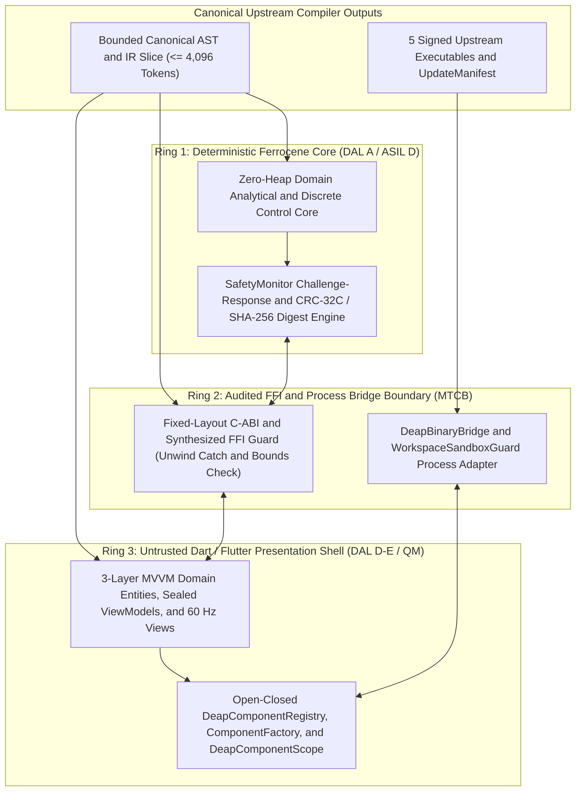
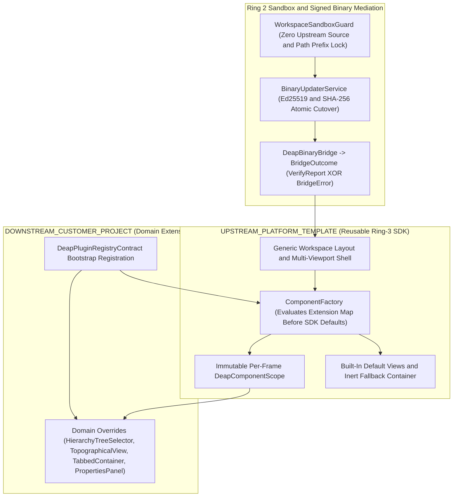

# Dart/Flutter HMI, 3-Ring Rust FFI Lowering & Open-Closed Presentation Extension Profile

> **Profile Identifier:** `DEAP-PROFILE-DART-FFI-001`
> **Architecture Layer:** Layer 2 -- System Architecture & Downstream Synthesis Profile (exported via [Downstream Profile Export Manifest](../README.md), governed by upstream `DOCUMENT_AND_SPECIFICATION_STANDARD.md`)
> **Companion Downstream Profiles:** [DART_FLUTTER_CODING_STANDARD.md](./DART_FLUTTER_CODING_STANDARD.md), [SAFETY_CRITICAL_REALTIME_UI_BLUEPRINT.md](./SAFETY_CRITICAL_REALTIME_UI_BLUEPRINT.md), [deap_ffi.h](./include/deap_ffi.h), [DOWNSTREAM_INSTALLATION_AND_CI_GUIDE.md](../DOWNSTREAM_INSTALLATION_AND_CI_GUIDE.md), [RUNTIME_METADATA_ENGINE_BLUEPRINT.md](../profile-target-app-runtime/RUNTIME_METADATA_ENGINE_BLUEPRINT.md), [PERSISTENCE_ARCHITECTURE_BLUEPRINT.md](../profile-target-app-runtime/PERSISTENCE_ARCHITECTURE_BLUEPRINT.md)

| Attribute | Specification Detail |
| :--- | :--- |
| **Profile Identifier** | `DEAP-PROFILE-DART-FFI-001` |
| **Version** | `2.2.0` |
| **Date** | `2026-11-15` |
| **Status** | `APPROVED / PRODUCTION-GRADE` |
| **Repository Scope** | `UPSTREAM_PLATFORM_TEMPLATE` and `DOWNSTREAM_CUSTOMER_PROJECT` |
| **Upstream Authorities** | `DOCUMENT_AND_SPECIFICATION_STANDARD.md`, `RUST_CODING_STANDARD.md`, `CANONICAL_AST_AND_IR_BLUEPRINT.md`, `COMPILE_SYSML_BLUEPRINT.md`, `POLY_REPO_BINARY_DISTRIBUTION_BLUEPRINT.md` |
| **Assurance Partitioning** | 3-Ring Containment (`Ring 1` Ferrocene Core, `Ring 2` FFI & Binary Bridge MTCB, `Ring 3` Flutter Presentation Shell) |

---

## 1. Executive Summary & Architectural Scope

This Layer 2 profile specifies the deterministic synthesis, Foreign Function Interface (FFI) boundary lowering, binary process mediation, and open-closed graphical component extension architecture for downstream DEAP operator consoles and desktop engineering environments. While `UPSTREAM_SPEC_CORE_COMPILER` remains pure Rust and language-neutral with respect to downstream UI toolkits, `UPSTREAM_PLATFORM_TEMPLATE` and `DOWNSTREAM_CUSTOMER_PROJECT` repositories mount this profile alongside [DART_FLUTTER_CODING_STANDARD.md](./DART_FLUTTER_CODING_STANDARD.md) and [SAFETY_CRITICAL_REALTIME_UI_BLUEPRINT.md](./SAFETY_CRITICAL_REALTIME_UI_BLUEPRINT.md) to govern:

1. **Canonical AST-to-3-Ring FFI Synthesis**: Deterministic lowering of bounded ($\le 4,096$ tokens) canonical SysML v2 / RAAML v1 AST slices ($\mathcal{M}_{\mathrm{codegen}} \subset \mathcal{M}_{\mathrm{SysML\ v2}}$) into `Ring 1` Ferrocene Rust domain/safety kernels, `Ring 2` fixed-layout C-ABI and synthesized `flutter_rust_bridge` FFI isolation guards, and `Ring 3` immutable Dart/Flutter MVVM presentation layers.
2. **Sequence-Numbered Readback & Challenge-Response Interlocks**: Hardware-grade actuation protection requiring every safety-critical command initiated in `Ring 3` to complete a two-step `Ring 1` `SafetyMonitor` readback and `CRC-32C` / `SHA-256` digest verification cycle prior to authorization.
3. **Open-Closed Desktop Presentation Extension (`DeapComponentRegistry`)**: Meyer open-closed component delegation enabling `DOWNSTREAM_CUSTOMER_PROJECT` workspaces to register custom domain views over `UPSTREAM_PLATFORM_TEMPLATE` via `DeapComponentScope` and `ComponentFactory` with zero platform source duplication and zero upstream compiler source leakage.

---

## 2. Canonical AST-to-Dart/Rust 3-Ring Lowering Semantics

### 2.1 Semantic Equivalence, Idempotency & Bounded Slice Lowering

Downstream synthesis consumes topological subgraph slices emitted by the signed upstream specification compiler (`compile-sysml`). Peripheral entities outside the $4,096$-token window are represented as typed `ExternalInterfaceRef` boundary stubs so every synthesized module is self-contained. Across every canonical state transition model $M_{\mathrm{SysML}} = \langle S, S_0, \Sigma, \delta, F \rangle$ and lowered 3-Ring realization $M_{\mathrm{FFI\_HMI}}$, synthesis preserves reachable safety invariants and deterministic digest equivalence:

$$
\begin{aligned}
\forall s \in \operatorname{Reach}(M_{\mathrm{SysML}}), \quad \phi(s) &\implies \forall s' \in \operatorname{Reach}(M_{\mathrm{FFI\_HMI}}), \quad \phi(s') \\
\operatorname{Synthesize}(\mathrm{AST}_{t}) = \operatorname{Synthesize}(\mathrm{AST}_{t+\Delta t}) &\iff \operatorname{Digest}(\mathrm{AST}_{t}) \equiv \operatorname{Digest}(\mathrm{AST}_{t+\Delta t})
\end{aligned}
$$

### 2.2 Three-Ring Synthesis Responsibility & Lowering Mapping

| Canonical IR Construct | Ring 1 Lowering (Ferrocene Certified Core) | Ring 2 Lowering (Audited FFI & Bridge MTCB) | Ring 3 Lowering (Dart / Flutter MVVM Shell) |
| :--- | :--- | :--- | :--- |
| **Structural Classifiers & Value Types** | Fixed-capacity value records with zero dynamic heap allocation post-init and total checked/saturating arithmetic. | Fixed-layout C-ABI transfer descriptors validating finite IEEE 754 scalars, non-empty identifiers, and range bounds. | Immutable Dart value objects with private constructors, `Result<T>` factories, structural equality, and pure DTO separation. |
| **Hierarchical Statecharts & Guards** | Deterministic mode-supervision transition tables proven free of uncommanded fault-to-nominal recovery. | Snapshot ring-buffer projection tagging each state frame with monotonic sequence numbers and Castagnoli `CRC-32C` digests. | Exhaustive `sealed class` UI state hierarchies driving pure side-effect-free widget `build` projections at $60\,\text{Hz}$. |
| **Directional Command & Telemetry Ports** | Bounded static ring-buffer ingress and egress ports gated by `SafetyMonitor` precondition predicates. | Synthesized `flutter_rust_bridge` boundary wrappers trapping native unwinds and translating boundary faults into closed error codes. | Narrow segregated repository interfaces, frame-paced telemetry coalescers, and `_disposed`-guarded reactive ViewModels. |
| **Safety Invariants & Interlocks** | Formal bounded model checking proof obligations and two-step readback challenge-response digest verification. | Fail-closed sequence-gap, epoch-staleness, and digest-mismatch rejection prior to Ring 1 dispatch. | Verbatim rendering of Ring-1-echoed readback payloads and explicit degraded/stale-interlock banners on any fault. |

---

## 3. Ring-2 FFI Soundness, Challenge-Response Interlocks & 5-Stage Verification

### 3.1 Two-Step `SafetyMonitor` Challenge-Response Protocol

Ring 3 operates inside a `DO-178C DAL-D/E` / `ISO 26262 QM` containment envelope where garbage-collected isolate pauses, GPU driver anomalies, or presentation layout defects must never corrupt Ring 1 control state or trigger unverified actuation. Every safety-critical command $c$ at monotonic epoch $e_k$ and sequence index $q_k$ traverses a four-phase deterministic handshake:

1. **Propose (`Ring 3 -> Ring 2 -> Ring 1`)**: Ring 3 submits a typed command proposal across the Ring 2 FFI guard without mutating local state optimistically.
2. **Readback & Challenge (`Ring 1 -> Ring 2 -> Ring 3`)**: The Ring 1 `SafetyMonitor` validates operational mode preconditions, allocates challenge token $\tau_k$ with freshness deadline $\Delta t_{\mathrm{ack}}$, and emits an immutable readback frame carrying $(q_k, e_k, c_{\mathrm{norm}}, d_k)$ where $d_k = \operatorname{SHA256}(q_k \parallel e_k \parallel c_{\mathrm{norm}})$.
3. **Operator Confirm (`Ring 3 -> Ring 2`)**: The operator reviews the verbatim Ring-1-echoed readback parameters rendered in Ring 3 and submits confirmation bound to $(q_k, \tau_k, d_k)$.
4. **Authorize (`Ring 1`)**: Ring 1 commits the actuation transition if and only if sequence monotonicity, freshness, token equality, and cryptographic digest parity hold simultaneously:

$$
\begin{aligned}
\operatorname{Authorize}(q_k, e_k, \tau_k, d_k) \iff q_k = q_{k-1} + 1 \;\land\; (t_{\mathrm{now}} - t_{\mathrm{issue}}) \le \Delta t_{\mathrm{ack}} \;\land\; \tau_k = \tau_{\mathrm{expected}} \;\land\; d_k = \operatorname{SHA256}(q_k \parallel e_k \parallel c_{\mathrm{norm}})
\end{aligned}
$$

Any sequence gap, timeout, unwind trap, or digest mismatch forces an immediate transition into a closed `Failure` / stale-interlock state with zero Ring 1 actuation side effects.

### 3.2 Five-Stage Cross-Language Qualification Gate

Synthesized Ring 1, Ring 2, and Ring 3 artifacts must jointly pass five deterministic verification stages under root `criticalup.toml` and [DART_FLUTTER_CODING_STANDARD.md](./DART_FLUTTER_CODING_STANDARD.md):

1. **Stage 1 -- Qualified Static Linting & Fatal-Info Analysis**: Enforces panic-free total error handling and structural complexity bounds on the Ferrocene Rust side alongside zero-diagnostic `dart analyze --fatal-infos` and `flutter analyze --fatal-infos --fatal-warnings` across all synthesized and consumer FFI bindings.
2. **Stage 2 -- Intermediate-Representation Zero-Heap & Boundary Audit**: Verifies at the compiler IR level that Ring 1 allocates zero dynamic heap memory post-initialization and every Ring 2 FFI entry point documents and enforces its safety-justification contract.
3. **Stage 3 -- Dynamic Aliasing & Memory-Model Verification**: Executes symbolic pointer-aliasing and Tree Borrows verification (`Miri`) across Ring 1 and Ring 2 C-ABI marshaling paths to prove absence of undefined behavior, out-of-bounds reads, and data races.
4. **Stage 4 -- Bounded Model Checking & Frame-Budget Parity**: Discharges bounded model checking proof harnesses for Ring 1 state containment while verifying Ring 3 $60\,\text{Hz}$ ($\le 0.01667\,\text{s}$ total frame time, $\le 0.008\,\text{s}$ UI isolate build/layout, $> 0.002\,\text{s}$ worker isolate offload) and `1080p`--`6K` pairwise HUD bounding-box non-overlap against live SQLite persistence ([PERSISTENCE_ARCHITECTURE_BLUEPRINT.md](../profile-target-app-runtime/PERSISTENCE_ARCHITECTURE_BLUEPRINT.md)).
5. **Stage 5 -- Disjoint Baseline Parity Verification (`TQL-5`)**: Executes the signed upstream `verify-baseline` executable to confirm traceability and schema digest parity across Layer 3 models, Layer 4 designs, and 3-Ring target realizations.

---

## 4. Open-Closed Presentation Extension Boundary (`DeapComponentRegistry`)

To allow `UPSTREAM_PLATFORM_TEMPLATE` to evolve its reusable desktop layout shell without breaking domain widgets in `DOWNSTREAM_CUSTOMER_PROJECT` repositories, the Ring 3 presentation architecture enforces the Open-Closed Principle via `DeapComponentRegistry`, `DeapComponentScope`, and `ComponentFactory`, paired with Ring 2 binary bridge mediation.

### 4.1 `DeapComponentScope` & Ring 2 Binary Bridge M2 Contract (`REQ-DIST-001`)

| Architectural Element | Assurance Ring | Conceptual Responsibility | Architectural Invariant | Assurance & Containment Guarantee | Realizes |
| :--- | :--- | :--- | :--- | :--- | :--- |
| `DeapComponentBuilder` | `Ring 3` | Constructs a bounded presentation element from validated node metadata and an immutable per-frame component scope. | Every metadata key is non-empty and builder evaluation always yields a valid presentation element. | Deterministic `O(1)` view construction with zero untyped dynamic layout parameters (`TQL-5` verifiable). | `REQ-DIST-001` |
| `DeapComponentScope` | `Ring 3` | Exposes immutable per-frame active view identifier, analytical snapshot, hierarchy state, and preferred split orientation. | Active view identifier is non-empty and split orientation belongs to the closed horizontal-or-vertical axis set. | Immutable per-frame read-only context with `O(1)` member access and zero untyped dynamic casts (`TQL-5`). | `REQ-DIST-001` |
| `DeapComponentScope` (`onViewSelected`) | `Ring 3` | Schedules asynchronous view transitions in response to operator navigation selections. | Requested view identifier is non-empty and transition scheduling never mutates the frame tree synchronously during build. | Deterministic `O(1)` event dispatch safely ignoring unrecognized view identifiers without fault propagation. | `REQ-DIST-001` |
| `DeapComponentScope` (`resolveTabLabel`) | `Ring 3` | Resolves human-readable presentation labels from logical tab identifiers. | Pure mapping returning a non-empty display label for every non-empty logical tab identifier. | Side-effect-free `O(1)` lookup returning the logical tab identifier as fallback when unmapped. | `REQ-DIST-001` |
| `DeapComponentScope` (`buildChildWidget`) | `Ring 3` | Delegates nested child subtree construction back through the open-closed registry boundary. | Downstream extension overrides retain strict precedence over built-in defaults across all child subtrees. | Deterministic `O(1)` per-node dispatch returning a safe inert fallback container on unrecognized element types. | `REQ-DIST-001` |
| `Finding` | `Ring 2` | Immutable diagnostic record conveying rule identifier, workspace-relative artifact path, positive line index, and message across the verifier boundary. | Rule identifier and artifact path are non-empty and 1-based line index satisfies $\ell \ge 1$. | Immutable structural value semantics with deterministic schema validation across `Ring 2`. | `REQ-DIST-001` |
| `VerifyReport` | `Ring 2` | Aggregated immutable verification outcome summarizing pass status, total evaluated rules, and finding collection. | Pass predicate holds if and only if finding cardinality is zero ($N_{\mathrm{find}} = 0$) and $N_{\mathrm{checks}} \ge N_{\mathrm{find}}$. | Unmodifiable boundary collection guaranteeing deterministic provenance reporting from `Ring 1` to `Ring 3`. | `REQ-DIST-001` |
| `BridgeError` | `Ring 2` | Structured boundary fault descriptor capturing failure category, process exit status, and bounded diagnostic context. | Failure category and diagnostic context are non-empty whenever boundary invocation fails. | Closed `Ring 2` fault taxonomy eliminating raw unchecked exception propagation into `Ring 3`. | `REQ-DIST-001` |
| `BridgeOutcome` | `Ring 2` | Mutually exclusive boundary outcome uniting a verified report on success or a structured bridge error on failure. | Exclusive disjunction between valid verification report presence and structured bridge error presence. | Exhaustive error handling across process and FFI boundaries between `Ring 3` shells and `Ring 1` tools. | `REQ-DIST-001` |
| `DeapBinaryBridge` | `Ring 2` | Minimal Trusted Computing Base (`MTCB`) adapter invoking verified upstream executables against a canonicalized workspace root. | Workspace root is non-empty and process invocation uses direct argument vectors without shell interpolation. | Confines external process execution within `Ring 2` with bounded execution timeout $\Delta t_{\mathrm{exec}} \le T_{\mathrm{bridge}}\,\text{s}$. | `REQ-DIST-001` |

For every `Ring 2` binary bridge invocation returning outcome $o = (\mathrm{ok}, r, e)$ over active view state $v$, total fault-containment exclusivity satisfies:

$$
|v| > 0 \;\land\; \bigl((\mathrm{ok} \land r \neq \varnothing \land e = \varnothing) \;\lor\; (\neg \mathrm{ok} \land r = \varnothing \land e \neq \varnothing)\bigr)
$$

### 4.2 `ComponentFactory` Open-Closed Delegation & `WorkspaceSandboxGuard` (`REQ-DIST-002`)

`ComponentFactory` evaluates registered downstream builders before built-in SDK defaults so `DOWNSTREAM_CUSTOMER_PROJECT` workspaces override `HierarchyTreeSelector`, `TopographicalView`, `TabbedContainer`, and `PropertiesPanel` through `DeapComponentScope` ([RUNTIME_METADATA_ENGINE_BLUEPRINT.md](../profile-target-app-runtime/RUNTIME_METADATA_ENGINE_BLUEPRINT.md)) without modifying `ComponentFactory`:

| Architectural Element | Assurance Ring | Conceptual Responsibility | Architectural Invariant | Assurance & Containment Guarantee | Realizes |
| :--- | :--- | :--- | :--- | :--- | :--- |
| `ComponentFactory` | `Ring 3` | Delegates presentation view construction across uniquely keyed downstream extension builders prior to built-in platform defaults. | Registered component-type keys are pairwise distinct across the extension map. | Open-closed `Ring 3` widget delegation with zero untyped casts (`TQL-5`). | `REQ-DIST-002` |
| `ComponentFactory` (`build`) | `Ring 3` | Resolves a bounded presentation handle for any node descriptor within positive viewport dimensions. | Viewport dimensions satisfy $W > 0$ and $H > 0$, and resolution always terminates in a valid handle. | Deterministic `O(1)` builder lookup falling back to an inert empty container on unknown component types. | `REQ-DIST-002` |
| `WorkspaceSandboxGuard` | `Ring 2` | Enforces repository tier isolation across canonical workspace roots and upstream-versus-downstream role classification. | Non-upstream workspaces contain zero upstream specification compiler source directories ($N_{\mathrm{up\_src}} = 0$). | Fails closed against upstream compiler source leakage in downstream workspaces (`TQL-5`). | `REQ-DIST-002` |
| `WorkspaceSandboxGuard` (`validateWorkspaceBoundary`) | `Ring 2` | Verifies that every candidate filesystem operation remains strictly inside the canonical workspace root perimeter. | Candidate path is non-empty and canonical resolution preserves the workspace root prefix. | Deterministic canonical path confinement blocking parent-directory traversal and symlink escapes across `Ring 2`. | `REQ-DIST-002` |

Let $M_{\mathrm{ext}} : \mathcal{K} \rightharpoonup \mathcal{C}$ denote registered downstream builders, $M_{\mathrm{sdk}} : \mathcal{K} \rightharpoonup \mathcal{C}$ denote built-in platform SDK builders, and $c_{\varnothing} \in \mathcal{C}$ denote the inert fallback container. For every positive viewport $(W, H) \in \mathbb{R}_{>0}^2$ and component key $k \in \mathcal{K}$, open-closed precedence and downstream source isolation satisfy:

$$
\Phi(k) = \begin{cases} M_{\mathrm{ext}}(k) & \text{if } k \in \operatorname{dom}(M_{\mathrm{ext}}), \\ M_{\mathrm{sdk}}(k) & \text{if } k \notin \operatorname{dom}(M_{\mathrm{ext}}) \land k \in \operatorname{dom}(M_{\mathrm{sdk}}), \\ c_{\varnothing} & \text{otherwise,} \end{cases} \qquad \neg \mathrm{isUpstream}(\mathcal{W}) \implies N_{\mathrm{up\_src}}(\mathcal{W}) = 0
$$

### 4.3 Declarative Plugin Registration & Signed Binary Updater Integration (`REQ-DIST-003`)

| Architectural Element | Assurance Ring | Conceptual Responsibility | Architectural Invariant | Assurance & Containment Guarantee | Realizes |
| :--- | :--- | :--- | :--- | :--- | :--- |
| `DeapPluginRegistryContract` | `Ring 3` | Declarative downstream registration contract binding logical component identifiers to domain presentation builders. | Every registered entry carries a non-empty logical component-type identifier. | Preserves upstream `ComponentFactory` immutability across downstream upgrades (`TQL-5`). | `REQ-DIST-003` |
| `UpdateChannel` | `Ring 2` | Closed release-stream taxonomy distinguishing qualified production releases, formal verification streams, and pinned release tags. | Every distribution channel belongs to the closed qualified release-channel set pinned via `criticalup.toml`. | Prevents unverified or ad-hoc compiler builds from entering downstream workspaces (`TQL-5`). | `REQ-DIST-003` |
| `PlatformArtifact` | `Ring 2` | Immutable per-platform binary descriptor specifying target architecture, binary identifier, `SHA-256` digest, payload size, and source URI. | Payload size satisfies $s > 0\,\text{B}$ and hexadecimal `SHA-256` digest length equals $64$ characters ($32\,\text{B}$). | Immutable cryptographic digest lock per host target architecture (`TQL-5`). | `REQ-DIST-003` |
| `UpdateManifest` | `Ring 2` | Signed poly-repo release manifest aggregating schema revision, release channel, version tag, platform descriptors, and `Ed25519` signature. | Schema revision satisfies $v_{\mathrm{schema}} \ge 1$ and platform artifact set is non-empty. | Detached `Ed25519` signature binds release tag and all platform digests atomically (`TQL-5`). | `REQ-DIST-003` |
| `UpdateError` | `Ring 2` | Closed boundary fault taxonomy covering digest mismatch, invalid signature, sandbox violation, unsupported target architecture, and swap failure. | Every failed update transition yields a deterministic, typed fault category with zero untyped string errors. | Closed failure handling across `Ring 2` binary staging and cutover (`TQL-5`). | `REQ-DIST-003` |
| `BinaryUpdaterService` | `Ring 2` | Audited `MTCB` distribution service managing manifest verification, sandboxed staging, and atomic binary activation. | Target installation perimeter is canonically prefixed by the `WorkspaceSandboxGuard` workspace root. | Verifies `Ed25519` signature and `SHA-256` digest prior to staging within bounded window $\Delta t_{\mathrm{stage}} \le T_{\mathrm{max}}\,\text{s}$. | `REQ-DIST-003` |
| `BinaryUpdaterService` (`installArtifact`) | `Ring 2` | Stages, verifies, and atomically activates a platform binary artifact inside a non-upstream workspace. | Pre-verified payload satisfies $s > 0\,\text{B}$ and activation succeeds only when workspace role is non-upstream. | Atomic staging-to-active cutover preventing partial or corrupted binary execution (`TQL-5`). | `REQ-DIST-003` |

For every candidate artifact $a$ of size $s_a\,\text{B}$ under manifest $\mathcal{M}$ and workspace root $r_{\mathrm{ws}}$, atomic activation admissibility requires:

$$
s_a > 0\,\text{B} \;\land\; |d_{\mathrm{hex}}(a)| = 64 \;\land\; \operatorname{prefix}(r_{\mathrm{ws}}, \operatorname{canon}(p_{\mathrm{install}})) = \mathrm{true} \;\land\; \neg \mathrm{isUpstream}(\mathcal{W})
$$

---

## 5. Non-Duplication & Profile Compliance Invariants

1. **Platform Layout & Bridge Non-Duplication**: `DOWNSTREAM_CUSTOMER_PROJECT` workspaces consuming `UPSTREAM_PLATFORM_TEMPLATE` fail closed if they duplicate platform workspace layout, theming, or `BridgeOutcome` modules instead of registering overrides via `DeapComponentRegistry` and `DeapPluginRegistryContract`.
2. **Pure Layer 2 Stratification & Exported C11 Boundary Header**: Concrete Dart package layouts and CLI flag bindings reside in downstream specifications and [DOWNSTREAM_INSTALLATION_AND_CI_GUIDE.md](../DOWNSTREAM_INSTALLATION_AND_CI_GUIDE.md), while `libdeap_ffi` (`cdylib` / `staticlib`, `#![forbid(unsafe_code)]`) exposes the bounded 4,096-byte `#[repr(C)]` ABI declared in [deap_ffi.h](./include/deap_ffi.h) (`deap_ffi_verify_bundle`, `deap_ffi_run_stage`, `FfiSliceDesc`, `FfiFixedBuffer`, and `FfiStatus`).
3. **Self-Contained Downstream Link Hygiene**: All references within this profile resolve strictly inside `downstream-profiles/` ([../README.md](../README.md)) in pure 7-bit ASCII.
