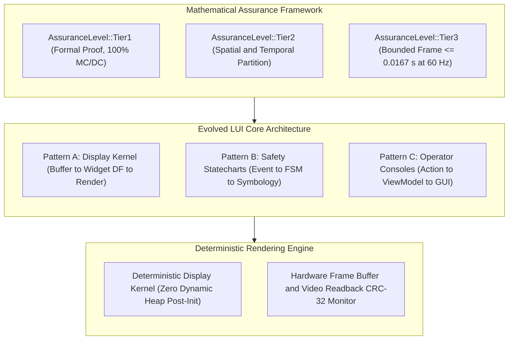
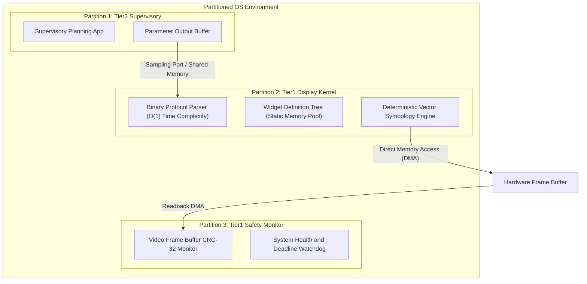
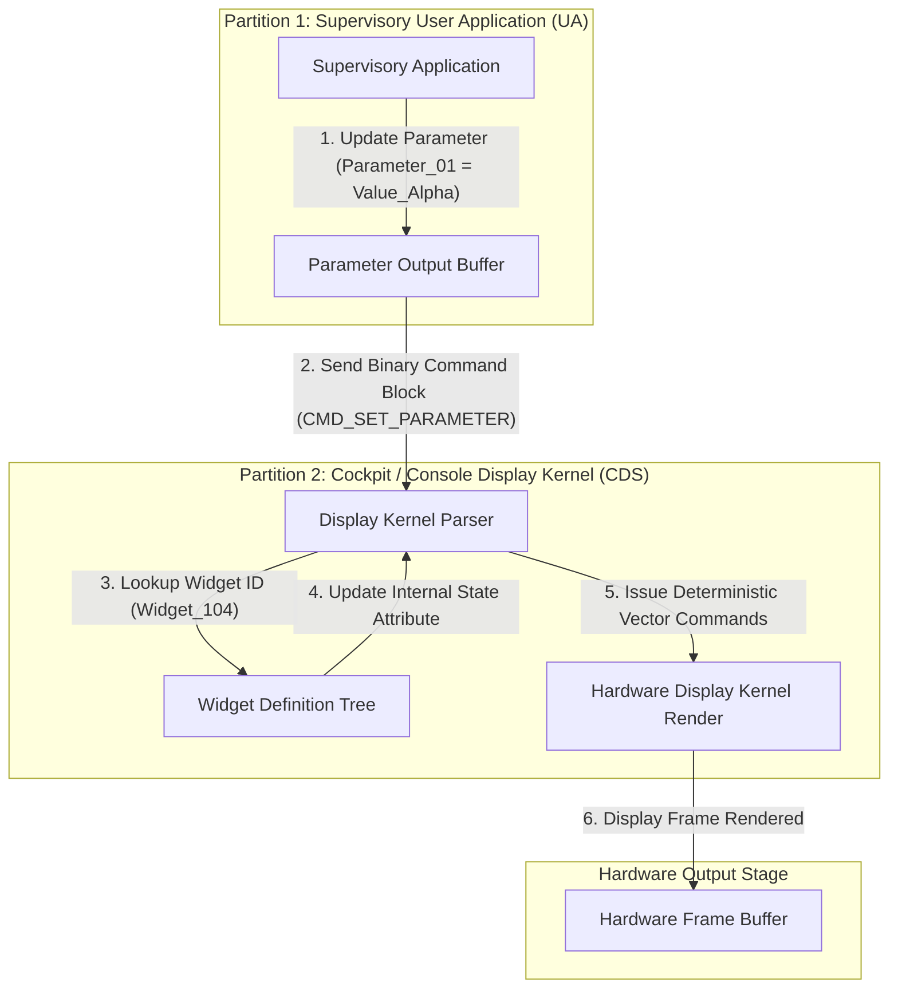
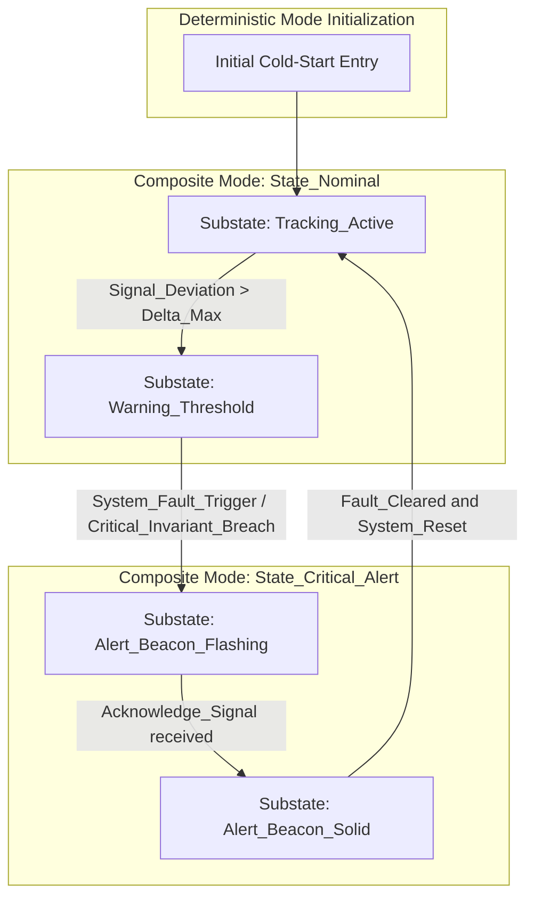
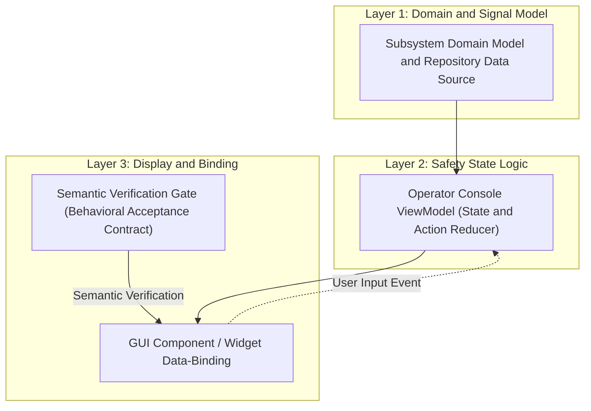
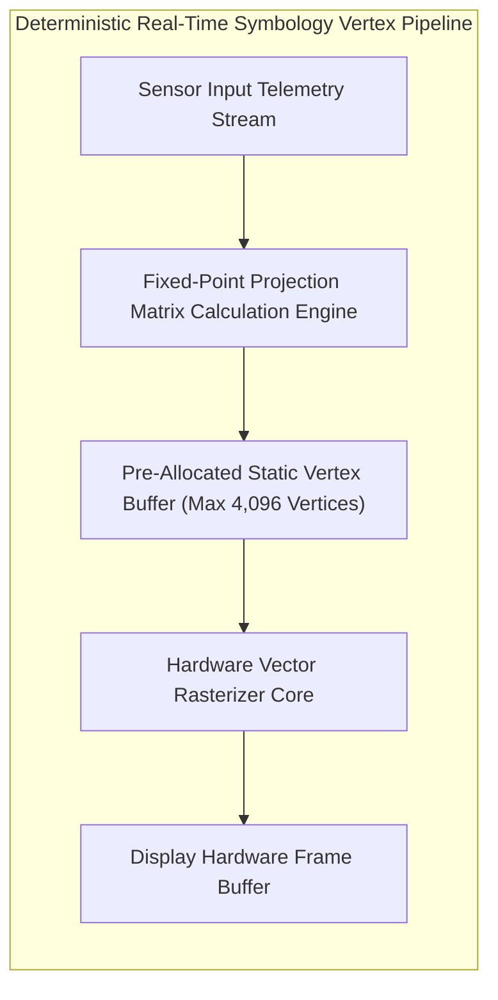

# Safety-Critical Real-Time UI Framework & Deterministic State Machine Architecture Blueprint

> **Document Identifier:** `DEAP-BLUEPRINT-SAFETY-UI-001`
> **Version:** `2.1.0`
> **Last Updated:** `2026-11-12`
> **Architecture Layer:** Layer 2 -- Downstream HMI Architecture Blueprint (exported via [Downstream Profile Export Manifest](../README.md), governed by upstream `DOCUMENT_AND_SPECIFICATION_STANDARD.md`)
> **Companion Downstream Profiles:** [DART_FLUTTER_CODING_STANDARD.md](./DART_FLUTTER_CODING_STANDARD.md), [DART_RUST_FFI_SYNTHESIS_PROFILE.md](./DART_RUST_FFI_SYNTHESIS_PROFILE.md), [RUNTIME_METADATA_ENGINE_BLUEPRINT.md](../profile-target-app-runtime/RUNTIME_METADATA_ENGINE_BLUEPRINT.md), [PERSISTENCE_ARCHITECTURE_BLUEPRINT.md](../profile-target-app-runtime/PERSISTENCE_ARCHITECTURE_BLUEPRINT.md)

| Attribute | Specification Detail |
| :--- | :--- |
| **Document Identifier** | `DEAP-BLUEPRINT-SAFETY-UI-001` |
| **Title** | Safety-Critical Real-Time UI Framework & Deterministic State Machine Architecture Blueprint |
| **Version** | `2.1.0` |
| **Date** | `2026-11-12` |
| **Status** | `APPROVED / PRODUCTION-GRADE` |
| **Classification** | `DOWNSTREAM_PROFILE_DART_FLUTTER_HMI` (`UPSTREAM_PLATFORM_TEMPLATE` & `DOWNSTREAM_CUSTOMER_PROJECT`) |
| **Architecture Layer** | Layer 2 -- System Architecture Blueprint (upstream `DOCUMENT_AND_SPECIFICATION_STANDARD.md`) |
| **Upstream Compiler Interface** | Signed release binaries from `UPSTREAM_SPEC_CORE_COMPILER` (`CANONICAL_AST_AND_IR_BLUEPRINT.md`, `COMPILE_SYSML_BLUEPRINT.md`, see [../README.md](../README.md)) |
| **Assurance Level** | `AssuranceLevel::Tier1..Tier5` (3-Ring Ferrocene Deterministic Execution & Formal Verification) |
| **Target Technology Profile** | Qualified Deterministic Core & Real-Time UI Execution (`criticalup.toml`, upstream `RUST_CODING_STANDARD.md`, [DART_FLUTTER_CODING_STANDARD.md](./DART_FLUTTER_CODING_STANDARD.md), [DART_RUST_FFI_SYNTHESIS_PROFILE.md](./DART_RUST_FFI_SYNTHESIS_PROFILE.md)) |

---

## 1. Executive Summary & Vision

### 1.1 Architectural Vision
In high-assurance industrial control systems and autonomous infrastructure, operator displays, supervisory control consoles, and real-time state visualizations are safety-critical components. Rendering anomalies, latency spikes, or corrupted telemetry displays can mislead supervisory operators or automated decision engines, triggering catastrophic system failures.

This architectural blueprint (`DEAP-BLUEPRINT-SAFETY-UI-001` v2.1.0) operates as a **Layer 2 System Architecture Blueprint** within the DEAP Downstream Profile Export Bundle ([../README.md](../README.md)), aligned with upstream `DOCUMENT_AND_SPECIFICATION_STANDARD.md`, `CANONICAL_AST_AND_IR_BLUEPRINT.md`, and companion profile [DART_RUST_FFI_SYNTHESIS_PROFILE.md](./DART_RUST_FFI_SYNTHESIS_PROFILE.md). The framework operationalizes the **Evolved Logical UI (LUI)** architecture within the Digital Engineering Agent Platform (DEAP), decoupling presentation specifications from runtime rendering kernels and supporting deterministic, low-latency display execution across three canonical architectural patterns.

All models and requirements adhere strictly to the **Pure Schema-Driven Compiler Invariant**:
- Zero concrete domain kinetics or physical platform implementations (no domain-specific physical bodies, mechanical actuators, or specialized transport machinery).
- All architectures express state using abstract symbolic computer science primitives: `PartDef_Alpha`, `Subsystem_01`, `Port_A`, `Action_01`, `Constraint_Invariant`.
- Regulatory and safety standards are abstracted into formal mathematical assurance tiers: `AssuranceLevel::Tier1..5`.

### 1.2 Deterministic Safety Constraints
To satisfy `AssuranceLevel::Tier1` and `AssuranceLevel::Tier2` requirements, the Safety-Critical Real-Time UI Framework enforces non-negotiable runtime design constraints:

1. **Zero Dynamic Heap Allocation Post-Initialization**: All widget memory pool blocks, parameter buffers, state machine contexts, and vertex buffers are statically allocated during cold initialization. Runtime dynamic memory management (`malloc`, `free`, garbage collection) inside Ring 1 display kernels is strictly forbidden.
2. **Deterministic Bounded Frame Latency**: Display kernel processing operates on a fixed timing schedule (strict $60\text{ Hz}$ / $0.0167\text{ s}$ or $120\text{ Hz}$ / $0.00833\text{ s}$ frame deadline). Execution overruns trigger immediate partition isolation and fault recovery.
3. **Statically Bounded Recursion and Iteration**: Loop bounds and function call depths are statically verifiable at compile time, guaranteeing strictly finite execution time.
4. **Hardware Frame Readback & Video CRC Monitoring**: The display pipeline captures hardware frame output and performs real-time CRC-32 checksum comparison against calculated signatures to detect GPU stalls or pixel corruption.

---

## 2. Spatial, Temporal & 3-Ring Ferrocene Partitioning Architecture

The framework operates within a partitioned operating system environment mapped directly onto the **3-Ring Ferrocene Assurance Architecture** ([DART_RUST_FFI_SYNTHESIS_PROFILE.md](./DART_RUST_FFI_SYNTHESIS_PROFILE.md)), isolating safety-critical rendering and statechart kernels from supervisory presentation shells:

1. **Ring 1 (Deterministic Safety-Critical Core -- Partition 2 & Partition 3):** Pure, deterministic, zero-ambient-authority safety kernel operating with static bounded memory and zero dynamic heap allocation post-initialization. Executes the $O(1)$ binary protocol parser, static widget definition tree, Pattern B safety statecharts, and hardware frame-buffer CRC-32C integrity monitor.
2. **Ring 2 (Audited Isolation and Adaptation Boundary -- DMA & Sampling Port Bridge):** Guarded Minimal Trusted Computing Base (MTCB) FFI/IPC/DMA boundary mediating inter-partition sampling ports and hardware DMA transfers using fixed-layout framing descriptors, Castagnoli CRC-32C integrity checks, and zero-heap static ring buffers under explicit boundary safety invariants and formal aliasing verification.
3. **Ring 3 (Supervisory Presentation Shell -- Partition 1):** Lower-criticality supervisory planning and operator console shell hosting Pattern C reactive ViewModels and presentation views, architecturally isolated from Ring 1 by unidirectional lock-free ring buffers.

---

## 3. Evolved Logical UI (LUI) -- 3 Canonical Architectural Patterns

The framework defines 3 canonical architectural patterns to span the entire spectrum of safety-critical human-machine interfaces:

### 3.1 Pattern A: Deterministic Display Kernel Architecture
Pattern A governs standardized decoupled display systems where the primary application logic executes in an isolated partition and communicates with the display kernel via deterministic binary protocols.

#### Layer Mapping for Pattern A
1. **Layer 1 (Domain State & Signal Model)**: Supervisory Parameter Output Buffer / Telemetry Input Stream.
2. **Layer 2 (Logic & Safety State Management)**: Display Kernel Widget Definition Tree and Symbolic Attribute Registry.
3. **Layer 3 (Display & Actuator Interface Binding)**: Deterministic Display Kernel Vector Engine rendering to hardware frame buffer and actuator interface.

---

### 3.2 Pattern B: Real-Time Safety Statecharts & Symbology Engine
Pattern B is optimized for high-speed, discrete event-driven statechart execution and vector symbology generation.

#### Layer Mapping for Pattern B
1. **Layer 1 (Domain State & Signal Model)**: Continuous System State Vector $x(t) \in \mathbb{R}^n$ / Discrete Input Event Frame $\Sigma$.
2. **Layer 2 (Logic & Safety State Management)**: Safety Statechart / Hierarchical Finite State Machine (FSM) Mode Controller.
3. **Layer 3 (Display & Actuator Interface Binding)**: Vector Graphic Symbology with priority-based layer rasterization and Actuator Output Command Interface.

---

### 3.3 Pattern C: Decoupled Operator Consoles
Pattern C provides a model-driven, reactive presentation architecture for supervisory engineering consoles and operator workstations using verification-backed ViewModels governed by [DART_FLUTTER_CODING_STANDARD.md](./DART_FLUTTER_CODING_STANDARD.md) and [DART_RUST_FFI_SYNTHESIS_PROFILE.md](./DART_RUST_FFI_SYNTHESIS_PROFILE.md).

#### Layer Mapping for Pattern C
1. **Layer 1 (Domain State & Signal Model)**: Console Domain Model / Sensor Telemetry & Persistent Repository ([RUNTIME_METADATA_ENGINE_BLUEPRINT.md](../profile-target-app-runtime/RUNTIME_METADATA_ENGINE_BLUEPRINT.md), [PERSISTENCE_ARCHITECTURE_BLUEPRINT.md](../profile-target-app-runtime/PERSISTENCE_ARCHITECTURE_BLUEPRINT.md)).
2. **Layer 2 (Logic & Safety State Management)**: ViewModel / Reactive State Holder handling user commands.
3. **Layer 3 (Display & Actuator Interface Binding)**: GUI Component / Widget Binding + Semantic Verification Gate asserting:
   `User Action -> ViewModel Action -> State Change -> Display/Actuator Binding Render`.

---

## 4. Bounded UI Model Slicing Mechanics ($\le 4,096$ Tokens)

To synthesize UI components and state machines within strict context boundaries, the synthesis pipeline slices UI metamodels (structural components, hierarchical states, guarded transitions, and typed ports) into discrete subgraphs:

$$
\begin{aligned}
\mathcal{V}_ {\text{ui-slice}} = \{w_0\} \cup \mathcal{N}_ {\text{child-widgets}}(w_0) \cup \mathcal{N}_ {\text{state-bindings}}(w_0)
\end{aligned}
$$

subject to the token constraint:

$$
\begin{aligned}
|\text{TokenCount}(\text{Serialize}(\mathcal{S}(w_0)))| \le 4096
\end{aligned}
$$

This ensures that agentic specification and code synthesis prompts are mathematically bounded, eliminating context window degradation.

---

## 5. Binary Protocol & Static Widget Subsystem

The framework models an $O(1)$ time complexity binary protocol parser operating with zero dynamic heap allocation:

| Field Offset | Parameter Identifier | Size (Bytes) | Description |
| :--- | :--- | :--- | :--- |
| `0x00` | `LayerId` | 2 | Unique Identifier of target Layer |
| `0x02` | `ContextId` | 2 | Application Execution Context ID |
| `0x04` | `StructureSize` | 2 | Total Size of Binary Command Block |
| `0x06` | `CommandId` | 2 | Command Identifier (e.g. `CMD_SET_PARAMETER`) |
| `0x08` | `WidgetId` | 2 | Target Widget Static Identifier |
| `0x0A` | `ParameterId` | 2 | Specific Parameter Identifier |
| `0x0C` | `ParamValue` | 4 / 8 | Parameter Value (Fixed-Point / IEEE 754 Float) |

---

## 6. Deterministic Real-Time Symbology Pipeline

Symbology generation requiring rapid frame updates utilizes a pre-allocated static vertex buffer:

---

## 7. Verification, Formal Coverage & BDD Acceptance Strategy

### 7.1 100% Modified Condition/Decision Coverage (MC/DC)
For safety-critical decision logic and guarded state transitions (e.g., independent Boolean guard conditions combined across signal thresholds and active invariants), all Boolean expressions in state transitions undergo formal condition isolation:
- Every condition must be shown to independently affect the decision outcome.
- Condition trees are statically extracted and verified through deterministic semantic acceptance and model-to-implementation parity harnesses.

### 7.2 Multi-Stage Deterministic Qualification & Verification Invariant
- Ad-hoc interpreted verification scripts are prohibited; qualification gates execute deterministically under the toolchain lock in root `criticalup.toml`, upstream `RUST_CODING_STANDARD.md`, and [DART_FLUTTER_CODING_STANDARD.md](./DART_FLUTTER_CODING_STANDARD.md).
- Verification spans static structural bounds enforcement, Ring 1 zero-heap memory isolation verification, Ring 2 boundary aliasing verification, bounded formal model checking of state transitions, and deterministic frame-budget parity testing.

---

## 8. Bi-Directional Architectural Traceability

Every element of the Real-Time UI Framework maintains bi-directional traceability across all five engineering layers (upstream `DOCUMENT_AND_SPECIFICATION_STANDARD.md`) and all three assurance rings (`Ring 1` through `Ring 3`):

$$
\begin{aligned}
[\text{System Requirement}] \longleftrightarrow [\text{Formal LUI Model}] \longleftrightarrow [\text{Projected Design / Safety Spec}] \longleftrightarrow [\text{Qualified Realization / Verification Gate}]
\end{aligned}
$$

---

## 9. Governance & Document Sign-Off

| Role | Domain Authority | Status | Verification Signature |
| :--- | :--- | :--- | :--- |
| **Real-Time Display Architect** | Framework Architecture & Timing | APPROVED | `Arch. Display, PE` |
| **Safety Assurance Lead** | Mathematical Assurance Tiers | APPROVED | `Lead. Assurance, SE` |
| **Forensic Quality Auditor** | Governance & Invariant Enforcement | APPROVED | `Audit. Teamwork, QA` |
