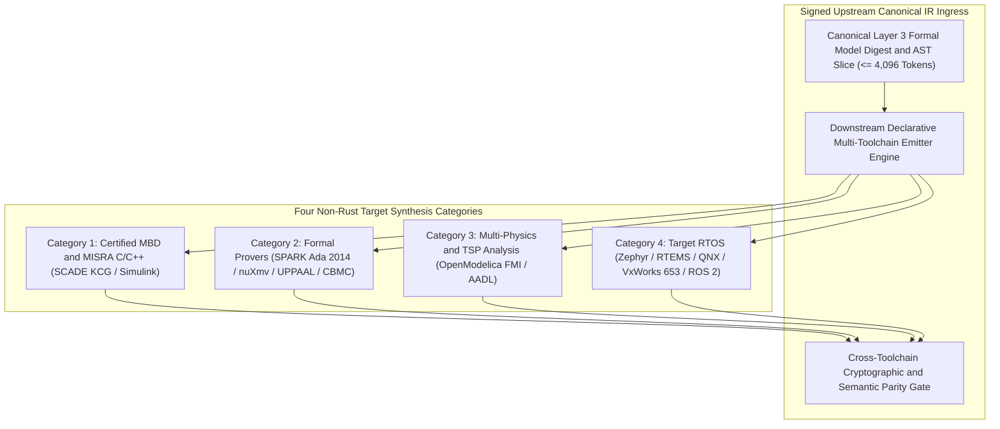
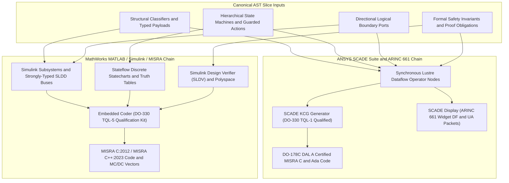
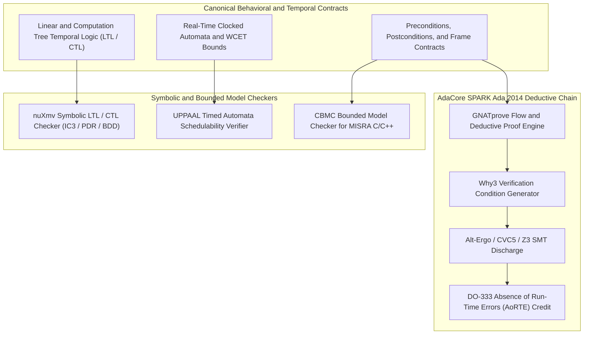
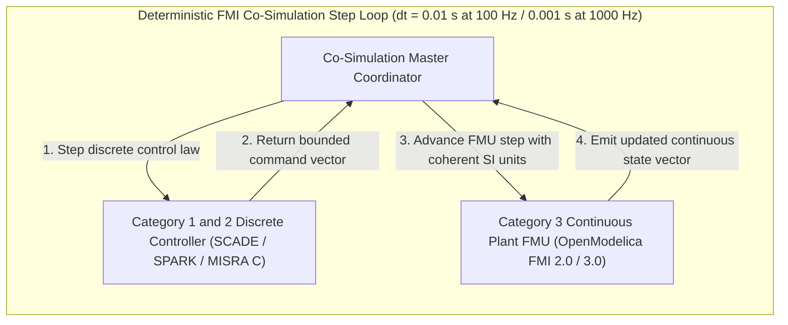

# Non-Rust Multi-Toolchain Synthesis, Formal Verification & Co-Simulation Profiles

> **Profile Identifier:** `DEAP-PROFILE-NON-RUST-001`
> **Architecture Layer:** Layer 2 -- Optional Downstream Target-Emitter & Co-Simulation Profile (`ISO/IEC/IEEE 42010`), exported via [Downstream Profile Export Manifest](../README.md) and governed by upstream `DOCUMENT_AND_SPECIFICATION_STANDARD.md`
> **Companion Downstream Profiles:** [SAFETY_CRITICAL_REALTIME_UI_BLUEPRINT.md](../profile-dart-flutter-hmi/SAFETY_CRITICAL_REALTIME_UI_BLUEPRINT.md), [DART_RUST_FFI_SYNTHESIS_PROFILE.md](../profile-dart-flutter-hmi/DART_RUST_FFI_SYNTHESIS_PROFILE.md), [RUNTIME_METADATA_ENGINE_BLUEPRINT.md](../profile-target-app-runtime/RUNTIME_METADATA_ENGINE_BLUEPRINT.md), [PERSISTENCE_ARCHITECTURE_BLUEPRINT.md](../profile-target-app-runtime/PERSISTENCE_ARCHITECTURE_BLUEPRINT.md)

| Attribute | Specification Detail |
| :--- | :--- |
| **Profile Identifier** | `DEAP-PROFILE-NON-RUST-001` |
| **Version** | `2.1.0` |
| **Date** | `2026-11-12` |
| **Status** | `APPROVED / PRODUCTION-GRADE` |
| **Repository Scope** | Optional Downstream Target-Emitter, Formal Verification, and Co-Simulation Repositories |
| **Upstream Compiler Input** | Canonical SysML v2 / RAAML v1 AST & IR slices emitted by signed `compile-sysml` binaries from `UPSTREAM_SPEC_CORE_COMPILER` ([../README.md](../README.md)) |
| **Target Ecosystems** | ANSYS SCADE (KCG & Display ARINC 661), MathWorks MATLAB/Simulink/Stateflow/Embedded Coder/SLDV, MISRA C/C++ & CBMC, AdaCore SPARK 2014, nuXmv/UPPAAL, OpenModelica FMI 2.0/3.0, OSATE AADL (`SAE AS5506D`), and 7 RTOS Platforms |

---

## 1. Executive Summary & Downstream Target-Emitter Positioning

### 1.1 Resolving Cross-Industry Safety-Critical Toolchain Silos

Engineering safety-critical cyber-physical systems across aerospace (`RTCA DO-178C DAL A`), automotive (`ISO 26262 ASIL D`), high-assurance automation (`Safety Assurance Tiers 1--5`), rail (`EN 50128 SIL 4`), and industrial control (`IEC 61508 SIL 4`) requires bridging abstract architectural specifications with heterogeneous target toolchains without contaminating the upstream specification core (`UPSTREAM_SPEC_CORE_COMPILER`). Historically, organizations suffered four disconnected silos:

1. **Commercial Model-Based Design (MBD) Silos:** Proprietary environments (**ANSYS SCADE Suite**, **MathWorks MATLAB / Simulink / Stateflow**) offer mature code generation (`DO-330 TQL-1` / `TQL-5`) but create vendor lock-in and binary-model CI friction when treated as primary system authoring stores.
2. **Formal Deductive & Symbolic Prover Silos:** Specialized verification teams running **AdaCore SPARK Ada 2014** (`GNATprove`) or symbolic model checkers (**nuXmv**, **UPPAAL**, **CBMC**) manually re-encode system invariants, inducing specification drift.
3. **Multi-Physics & Schedulability Analysis Silos:** Continuous acausal plant models in **OpenModelica / FMI 2.0 & 3.0** and Time and Space Partitioning (`TSP`) execution models in **OSATE / AADL (`SAE AS5506D`)** frequently drift from controller software baselines.
4. **Target RTOS Heterogeneity:** Synthesized control modules must deploy across bare-metal and partitioned kernels (**Zephyr RTOS**, **RTEMS**, **QNX Neutrino**, **Wind River VxWorks 653**, **ROS 2 / Micro-ROS**, **Generic_RTOS_Kernel**, and **Separation Microkernel**).

Optional downstream target-emitter repositories resolve all four silos by consuming verified canonical SysML v2 / RAAML v1 AST slices (`<= 4,096` tokens with typed `ExternalInterfaceRef` boundary stubs) emitted by the signed upstream `compile-sysml` binary ([../README.md](../README.md)) and projecting deterministic target models, formal contracts, co-simulation units, and RTOS bindings.

### 1.2 Core Mathematical Guarantees Across All Non-Rust Backends

1. **Semantic Equivalence (Reachability Preservation):** For every canonical state transition system $M_{\mathrm{SysML}} = \langle S, S_0, \Sigma, \delta, F \rangle$, the synthesized non-Rust target model or code $M_{\mathrm{Target}}$ preserves all reachable state invariants:

$$
\begin{aligned}
\forall s \in \operatorname{Reach}(M_{\mathrm{SysML}}), \quad \phi(s) \implies \forall s' \in \operatorname{Reach}(M_{\mathrm{Target}}), \quad \phi(s')
\end{aligned}
$$

2. **AST Idempotency & Byte-Exact Reproducibility:** Identical canonical AST digests yield byte-for-byte identical target artifacts:

$$
\begin{aligned}
\operatorname{Synthesize}(\mathrm{AST}_{t}) = \operatorname{Synthesize}(\mathrm{AST}_{t+\Delta t}) \iff \operatorname{Digest}(\mathrm{AST}_{t}) \equiv \operatorname{Digest}(\mathrm{AST}_{t+\Delta t})
\end{aligned}
$$

3. **Absence of Undefined Behavior & Zero Dynamic Heap Post-Init:** Synthesized MISRA C/C++ and SPARK Ada targets enforce static memory pools, bounded loop/call recursion, and zero runtime `malloc`/`free` allocation after cold initialization.

### 1.3 Four-Category Responsibility Matrix

| Synthesis Category | Primary Toolchains & Frameworks | Primary Function in Downstream Emitter Pipeline | Generated Artifacts & Formats | Target Safety Standards |
| :--- | :--- | :--- | :--- | :--- |
| **Category 1: Certified MBD & MISRA C/C++** | ANSYS SCADE Suite, SCADE KCG, SCADE Display, MATLAB, Simulink, Stateflow, Embedded Coder, SLDV, Polyspace | Synchronous dataflow modeling, continuous/discrete control synthesis, MISRA C:2012 / C++:2023 generation, ARINC 661 CDS generation | `.scade`, `.slx`, `.sldd`, MISRA C:2012 / MISRA C++:2023, Qualifiable Ada, ARINC 661 Server DFs | RTCA DO-178C (`DAL A/B`), DO-331, ISO 26262 (`ASIL D`), Safety Assurance Tiers 1--5, EN 50128 (`SIL 4`) |
| **Category 2: Non-Rust Formal Provers** | AdaCore SPARK Ada 2014 (`GNATprove`, Why3, Alt-Ergo, CVC5, Z3), `nuXmv`, `UPPAAL`, `CBMC` | Deductive Hoare contract proving, Absence of Run-Time Errors (`AoRTE`), LTL/CTL symbolic model checking, timed automata, C bounded model checking | `.ads`/`.adb` with SPARK contracts, `.smv` (`nuXmv`), `.xml` (`UPPAAL`), SMT-LIB2, CBMC proof harnesses | RTCA DO-178C / DO-333 (Formal Methods), ISO 26262 (`ASIL D`), IEC 61508 (`SIL 4`) |
| **Category 3: Multi-Physics & Co-Sim** | OpenModelica, FMI `2.0`/`3.0`, OSATE, AADL (`SAE AS5506D`) | Acausal continuous-discrete co-simulation, hardware-software processor/memory/bus binding, `TSP` schedulability and latency analysis | `.fmu` (`FMU-ME` / `FMU-CS`), `.mo` (Modelica), `.aadl` system models, RMA/EDF schedulability reports | SAE ARP4754A / ED-79A, SAE AS5506D (`AADL`), ISO 26262, IEC 61508, RTCA DO-178C / DO-254 (`TSP`) |
| **Category 4: Target RTOS Platforms** | Zephyr RTOS, RTEMS, QNX Neutrino, VxWorks 653, ROS 2 / Micro-ROS, `Generic_RTOS_Kernel`, Separation Microkernel | Deterministic periodic task execution, MPU/MMU spatial isolation, APEX queuing/sampling ports, DDS and software-bus IPC | C/C++/Ada task entrypoints, `.dts` devicetrees, VxWorks 653 XML manifests, `.msg` schemas, Kconfig/CMake builds | `TSP`, POSIX `PSE51/52`, CAST-32A / AC 20-193, ISO 26262 `ASIL D`, IEC 61508, ECSS Space Standards |

---

## 2. Category 1 -- Certified MBD & MISRA C/C++ Synthesis Profiles

### 2.1 ANSYS SCADE Suite, KCG (`DO-330 TQL-1`) & SCADE Display (`ARINC 661`)

- **Synchronous Lustre Dataflow Semantics:** Every SCADE node evaluates deterministic clock-synchronized equations at discrete ticks $k \in \mathbb{N}$ with acyclic single-tick dependency graphs, static memory pools, and zero dynamic heap allocation:

$$
\begin{aligned}
\forall k \ge 0, \quad y_k = f(x_k, s_k), \quad s_{k+1} = g(x_k, s_k)
\end{aligned}
$$

- **SCADE KCG `DO-330 TQL-1` Qualification:** Because KCG is qualified as a Criteria-1 `TQL-1` development tool, generated C or Ada code is certified semantically equivalent to the verified SCADE model, legally eliminating low-level object/source unit testing and structural code MC/DC under `RTCA DO-178C` Section 12.2.2 in favor of upstream model verification and SCADE Design Verifier proof discharge.
- **SCADE Display & `ARINC 661` CDS Integration:** Maps logical UI port contracts ([SAFETY_CRITICAL_REALTIME_UI_BLUEPRINT.md](../profile-dart-flutter-hmi/SAFETY_CRITICAL_REALTIME_UI_BLUEPRINT.md)) into certified `ARINC 661` Widget Definition Files (`DF`) and `A661_CMD_SET_PARAMETER` binary User Application (`UA`) packets rendered over OpenGL SC.

### 2.2 MathWorks MATLAB / Simulink / Stateflow, Embedded Coder (`DO-330 TQL-5`) & MISRA C/C++

- **Hybrid Continuous/Discrete & Stateflow Lowering:** Supports Runge-Kutta and Dormand-Prince ODE plant models paired with hierarchical Stateflow charts (`after(n, sec)`, `before(n, tick)`, truth tables, and parallel AND-states) backed by external Simulink Data Dictionaries (`.sldd`).
- **Embedded Coder (`DO-330 TQL-5`) & MISRA C:2012 / MISRA C++:2023 Profile:** Emits strict `MISRA C:2012` (Amendment 1--4) and `MISRA C++:2023` freestanding source code enforcing fixed-width integer types, zero pointer arithmetic outside verified static array bounds, zero recursion, zero dynamic allocation (`malloc`/`free`/`new`), and mandatory Software-in-the-Loop (`SIL`) / Processor-in-the-Loop (`PIL`) back-to-back parity plus $100\%$ target object-code `MC/DC`.
- **Simulink Design Verifier (`SLDV`) & Polyspace:** Discharges division-by-zero, overflow, and range containment proof obligations and synthesizes $100\%$ `MC/DC`, condition, and decision test vectors.

### 2.3 Comparative Evaluation & Semantic Lowering Strategy

| Architectural Dimension | ANSYS SCADE Suite (`KCG` / `Display`) | MathWorks Simulink / `Embedded Coder` | Downstream Emitter Selection Rule |
| :--- | :--- | :--- | :--- |
| **Mathematical Base** | Synchronous Lustre/Esterel discrete clocks | Hybrid continuous ODEs + Stateflow discrete charts | SCADE for discrete safety supervisors; Simulink for continuous dynamics |
| **Generator Qualification** | `DO-330 TQL-1` (eliminates low-level code unit test) | `DO-330 TQL-5` (requires `SIL/PIL` back-to-back & code `MC/DC`) | Select SCADE when program mandates `TQL-1` code-testing elimination |
| **Console Display Target** | Native `SCADE Display` (`ARINC 661` DF + OpenGL SC) | Simulink 3D Animation (prototyping only) | Synthesize `SCADE Display` for certified `ARINC 661` cockpit/console displays |
| **Formal Prover Engine** | SCADE Design Verifier | `SLDV` + Polyspace Bug Finder / Code Prover | Lower canonical safety constraints symmetrically to both provers |
| **SCM & Diff Ergonomics** | Textual `.scade` operator syntax | `.slx` + external `.sldd` / `.m` model-build scripts | Emit deterministic textual `.scade` and reproducible `.m`/`.sldd` scripts |

Canonical lowering maps composite components and payloads to SCADE operator nodes or Simulink subsystems + `.sldd` buses, hierarchical statecharts to clock-guarded Lustre automata or Stateflow charts with exhaustive transition coverage, and directional ports plus invariants to typed synchronous pins and prover proof obligations.

---

## 3. Category 2 -- Non-Rust Formal Contract & Symbolic Prover Profiles

### 3.1 AdaCore SPARK Ada 2014, Ravenscar & `DO-333` `AoRTE` Proofs

- **Hoare-Logic Design-by-Contract Lowering:** Canonical behavioral actions and invariants lower directly into SPARK 2014 specification aspects (`.ads`/`.adb`): `Pre => ...` (subprogram entry precondition), `Post => ...` (normal exit guarantee), `Contract_Cases => ...` (disjoint complete case partition), `Global => ...` (explicit state-variable frame contract), and `Depends => ...` (information-flow lineage), paired with the **Ravenscar** deterministic tasking profile (static tasks, priority ceiling protected objects, zero dynamic allocators).
- **Complete Absence of Run-Time Errors (`AoRTE`):** Through `GNATprove` (`Why3` + `Alt-Ergo`, `CVC5`, `Z3`), every verification condition is proven mathematically free ($P = 0$) of buffer/index overflow, division by zero, integer wrap-around, `NaN`/`Infinity` generation, and null/dangling dereference, claiming formal verification credit under `RTCA DO-178C / DO-333`.

### 3.2 Symbolic Model Checkers (`nuXmv`, `UPPAAL`, `CBMC`)

1. **`nuXmv` Infinite-State `LTL` / `CTL` Verification:** Synthesizes `.smv` transition modules verified via SAT/SMT `IC3/PDR` and `BDD` engines over real/integer arithmetic:

$$
\begin{aligned}
\mathcal{G}\left(\mathrm{c2LinkLost} \land \mathcal{F}_{\le 2.0}\,\mathrm{ackReceived} \implies \mathcal{G}_{\ge 2.0}\,\mathrm{modeSafeRTL}\right)
\end{aligned}
$$

2. **`UPPAAL` Timed Automata Verification:** Emits `.xml` networks of timed automata with continuous clocks $x, y \in \mathbb{R}_{\ge 0}$ ($\dot{x} = 1$) and invariant/transition guards ($x \le \mathrm{WCET}$) proving deadlock freedom and bounded distributed synchronization.
3. **`CBMC` Bounded Model Checking for `MISRA C/C++`:** Unwinds synthesized C/C++ loops and call graphs to depth $k$ to discharge pointer-safety, array-bounds, and assertion obligations:

$$
\begin{aligned}
\bigwedge_{i=0}^{k} \mathrm{Step}_{i} \land \neg \mathrm{Assertion} \implies \mathrm{UNSAT}
\end{aligned}
$$

---

## 4. Category 3 -- OpenModelica `FMI 2.0/3.0` & `OSATE / AADL` (`SAE AS5506D`) Co-Simulation

### 4.1 OpenModelica Acausal Multi-Physics & Functional Mock-up Units (`FMU`)

OpenModelica lowers continuous plant, electromechanical drive, energy-conversion, and thermal-dissipation equations into Differential Algebraic Equations (`DAE`s) packaged as `FMI 2.0 / 3.0` **Model Exchange (`FMU-ME`)** or internal-solver **Co-Simulation (`FMU-CS`)** units (`fmi2DoStep` / `fmi3DoStep`):

$$
\begin{aligned}
F\bigl(t, x(t), \dot{x}(t), y(t), u(t)\bigr) = 0
\end{aligned}
$$

### 4.2 `OSATE` & `AADL` (`SAE AS5506D`) `TSP` & End-to-End Schedulability

Canonical hardware-software allocations compile into formal `AADL` software components (`system`, `process`, `thread`, `subprogram`) bound to execution platform components (`processor`, `memory`, `bus`, `device`) annotated with `TSP` properties:
- **Spatial & Temporal Partition Isolation:** Verifies disjoint MMU/MPU address spaces and confirms every partition window fits inside the `TSP` Major Time Frame (e.g., $T_{\mathrm{Major}} = 0.10\,\text{s}$ at $10\,\text{Hz}$).
- **Worst-Case Response Time (`RMA` / `EDF`):** Computes end-to-end response time $R_i$ across tasks and `AFDX` / `CAN` / deterministic Ethernet buses against deadline $D_i$:

$$
\begin{aligned}
R_i = C_i + \sum_{j \in \mathrm{hp}(i)} \left\lceil \frac{R_i}{T_j} \right\rceil C_j \le D_i
\end{aligned}
$$

---

## 5. Category 4 -- Target Real-Time Execution Frameworks & RTOS Platforms

| Target Framework | Kernel Architecture | Primary Safety Standards | Memory Protection Model | Scheduling Semantics | Inter-Process Communication | Canonical AST Synthesis Target |
| :--- | :--- | :--- | :--- | :--- | :--- | :--- |
| **Zephyr RTOS** | Micro-configurable RTOS | `ISO 26262`, `IEC 61508` (Safety WG) | Hardware MPU user-space domains | Fixed-priority preemptive / cooperative | `k_msgq`, `k_fifo`, `k_sem` | `K_THREAD_DEFINE` static threads, `.dts` devicetrees, Kconfig |
| **RTEMS** | Deterministic SMP Executive | Space-qualified (`ECSS`) & `POSIX PSE51/52` | MMU/MPU partition protection | Deterministic SMP, Clustered `EDF` | `POSIX` message queues & priority-ceiling mutexes | `POSIX` `pthread` periodic tasks & rate-monotonic schedules |
| **QNX Neutrino** | Safety Microkernel | `ISO 26262 ASIL D`, Tiers 1--5 | Full MMU user-space driver/process isolation | Priority preemptive + adaptive partitioning | Synchronous `MsgSend` / `MsgReceive` / `MsgReply` & pulses | QNX resource managers & typed pulse-channel loops |
| **Wind River VxWorks 653** | `TSP` IMA Hypervisor | `DO-178C / DO-254 DAL A`, `CAST-32A` / `AC 20-193` | Strict `TSP` spatial partition address spaces | `TSP` Major Time Frame slot schedule | `APEX` sampling & queuing ports | `APEX` process entrypoints & XML module descriptors |
| **ROS 2 / Micro-ROS** | Real-Time `DDS` Middleware | `ISO 26262 ASIL D` (certifiable executors) | OS/MPU static allocator pools | Static single-threaded & callback-group executors | `OMG DDS` (`CycloneDDS` / `FastDDS`) | `ROS 2` lifecycle nodes & `.msg` schemas |
| **`Generic_RTOS_Kernel`** | Modular Deterministic Kernel | `RTA` Simplex Architecture (Tiers 1--5) | Hardware MPU process isolation | Preemptive fixed-priority task loop (zero heap) | High-rate async publish-subscribe bus | Native periodic task modules & mode supervisors |
| **Separation Microkernel** | Layered App Framework (`OSAL`/`PSP`/`SB`) | High-Assurance Space & Critical Control | `OSAL`-enforced partition boundaries | Priority-based periodic tables | Core Software Bus (`SB`) zero-copy pipes | Isolated applications, message IDs, & command handlers |

---

## 6. Universal Tool Qualification Matrix & Declarative Profile Standard

### 6.1 `DO-330` / `ISO 26262` / `EN 50128` / `IEC 61508` Qualification Mapping

Under `RTCA DO-330` and `DO-178C` (`DAL A` catastrophic failure rate bound $\le 2.78 \times 10^{-13}\,\text{s}^{-1}$), tool qualification derives from Software `DAL` and Tool Criteria (`Criteria 1` code/output generator, `Criteria 2` verification-bypass prover, `Criteria 3` error-detection verifier):

$$
\begin{aligned}
\operatorname{TQL}(\mathrm{DAL\ A}, \mathrm{Criteria\ 1}) &= \mathbf{TQL\text{-}1}, \qquad
\operatorname{TQL}(\mathrm{DAL\ A}, \mathrm{Criteria\ 2}) = \mathbf{TQL\text{-}2}, \qquad
\operatorname{TQL}(\mathrm{DAL\ A}, \mathrm{Criteria\ 3}) = \mathbf{TQL\text{-}5}
\end{aligned}
$$

| Software Safety Level | Criteria 1 (Generator) | Criteria 2 (Prover Bypass) | Criteria 3 (Verifier) | `ISO 26262-8` Clause 11 | `EN 50128` / `IEC 61508-3` |
| :--- | :--- | :--- | :--- | :--- | :--- |
| **`DAL A` / `ASIL D` / `SIL 4` / Class C** | `TQL-1` | `TQL-2` | `TQL-5` | `TCL 3` (`TI 2` + `TD 2/3`) | Class `T3` |
| **`DAL B` / `ASIL C` / `SIL 3`** | `TQL-2` | `TQL-3` | `TQL-5` | `TCL 2` / `TCL 3` | Class `T3` |
| **`DAL C` / `ASIL B` / `SIL 2` / Class B** | `TQL-3` | `TQL-4` | `TQL-5` | `TCL 2` | Class `T2` |
| **`DAL D` / `ASIL A` / `SIL 1` / Class A** | `TQL-4` | `TQL-5` | `TQL-5` | `TCL 1` | Class `T1` |

Downstream qualification pipelines emit the four standard compliance artifacts automatically: **Tool Qualification Plan (`TQP`)**, **Tool Operational Requirements (`TOR`)**, **Tool Verification Results (`TVR`)**, and `Ed25519`/`SHA-256`-attested **Tool Conformity Review (`TCR`)** packages.

### 6.2 Canonical Non-Rust Platform Synthesis Profile Domains

| Profile Domain | Target Assurance Qualification | Memory & Timing Containment Invariants | Formal & Structural Verification Obligations |
| :--- | :--- | :--- | :--- |
| **ANSYS SCADE KCG Profile** | `RTCA DO-330 TQL-1` / `DO-178C DAL A` (`MISRA C:2012` & `ARINC 661`) | Zero dynamic heap allocation; call-graph depth $\le 8$; stack frame $\le 1024\,\text{B}$; synchronous single-clock step $100\,\text{Hz}$ ($\Delta t = 0.01\,\text{s}$) | SCADE Design Verifier proof discharge across all synchronous invariant nodes and deterministic model-to-code traceability |
| **Simulink / MISRA C & C++ Profile** | `RTCA DO-330 TQL-5` / `DO-178C DAL A-B` / `ISO 26262 ASIL D` (`MISRA C:2012` & `C++:2023`) | Freestanding static memory pools; zero dynamic heap or recursion; fixed-step solver execution | `SLDV` + Polyspace + `CBMC` soundness discharge, `SIL/PIL` back-to-back equivalence, and $100\%$ target object-code `MC/DC` |
| **SPARK Ada 2014 Profile** | `RTCA DO-333` / `DO-178C DAL A` / `IEC 61508 SIL 4` (`GNATprove`) | Ravenscar deterministic tasking with priority ceiling locking and zero dynamic allocators | $100\%$ deductive `AoRTE` proof discharge across all `Why3` / SMT verification conditions with explicit `Global` and `Depends` contracts |
| **AADL `SAE AS5506D` TSP Profile** | `RTCA DO-178C / DO-254` / `CAST-32A` (`OSATE`) | Disjoint MMU/MPU spatial partitions; `TSP` Major Time Frame $T_{\mathrm{Major}} = 0.10\,\text{s}$ ($10\,\text{Hz}$) | `RMA` / `EDF` worst-case response-time proof ($R_i \le D_i$) across processor threads and deterministic communication buses |
| **OpenModelica FMI Profile** | `FMI 2.0 / 3.0` Continuous-Discrete Co-Simulation | IEEE 754 double-precision state exchange at fixed step $\Delta t = 1.0 \times 10^{-3}\,\text{s}$ ($1000\,\text{Hz}$); step `WCET` $\le 2.0 \times 10^{-4}\,\text{s}$ | Coherent SI unit dimensional consistency ($\text{rad}\cdot\text{s}^{-1}$, $\text{N}$, $\text{V}$, $\text{m}$, $\text{m}\cdot\text{s}^{-1}$) across directional `FMU` ports |

---

## 7. Profile Governance & Stratification Invariants

1. **Zero Upstream Core Contamination**: All non-Rust MBD, SPARK Ada, MISRA C/C++, AADL, FMI, and RTOS target-lowering profiles reside strictly inside `downstream-profiles/profile-non-rust-targets/` ([../README.md](../README.md)) so `UPSTREAM_SPEC_CORE_COMPILER` remains pure Ferrocene Rust.
2. **Pure Layer 2 Abstraction**: Concrete emitter CLI flags, schema files, and vendor runner scripts reside in downstream Layer 4 `docs/designs/` specifications.
3. **Pure 7-Bit ASCII & Self-Contained Links**: Encoded in pure 7-bit ASCII (`<= 0x7F`, LF-only) with all relative links resolving strictly inside `downstream-profiles/`.
