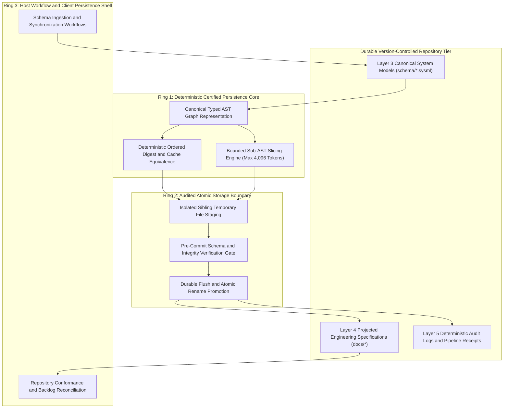
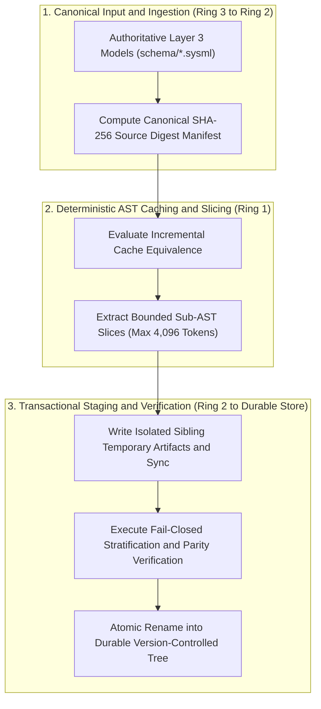

# DEAP Pure Rust Persistence, Zero-Ephemeral Storage & Strongly-Typed AST Caching Architecture Blueprint

> **Architecture Layer:** Layer 2 -- Downstream Target-Application Runtime Blueprint (exported via [Downstream Profile Export Manifest](../README.md), governed by upstream `DOCUMENT_AND_SPECIFICATION_STANDARD.md` -- Content-Addressed AST Persistence, Relational Seeding & Incremental Caching Architecture)

| Attribute | Specification Detail |
| :--- | :--- |
| **Document Identifier** | `DEAP-BLUEPRINT-PERSISTENCE-001` |
| **Title** | Pure Rust Persistence, Zero-Ephemeral Storage & Strongly-Typed AST Caching Architecture Blueprint |
| **Version** | `2.1.0` |
| **Date** | `2026-11-12` |
| **Status** | `APPROVED / PRODUCTION-GRADE` |
| **Classification** | `DOWNSTREAM_PROFILE_TARGET_APP_RUNTIME` (`UPSTREAM_PLATFORM_TEMPLATE` & `DOWNSTREAM_CUSTOMER_PROJECT`) |
| **Assurance Containment** | Ring 1 Deterministic Certified Core & Ring 2 Audited Storage Boundary (Zero-Ephemeral Storage) |
| **Companion Downstream Profiles** | [RUNTIME_METADATA_ENGINE_BLUEPRINT.md](./RUNTIME_METADATA_ENGINE_BLUEPRINT.md), [SAFETY_CRITICAL_REALTIME_UI_BLUEPRINT.md](../profile-dart-flutter-hmi/SAFETY_CRITICAL_REALTIME_UI_BLUEPRINT.md), [DART_RUST_FFI_SYNTHESIS_PROFILE.md](../profile-dart-flutter-hmi/DART_RUST_FFI_SYNTHESIS_PROFILE.md), [DART_FLUTTER_CODING_STANDARD.md](../profile-dart-flutter-hmi/DART_FLUTTER_CODING_STANDARD.md) |
| **Normative Governance** | Upstream `DOCUMENT_AND_SPECIFICATION_STANDARD.md` (`ISO/IEC/IEEE 42010` System Architecture Description) & `CANONICAL_AST_AND_IR_BLUEPRINT.md` |

---

## 1. Executive Summary & Zero-Ephemeral Persistence Invariant

The **Digital Engineering Agent Platform (DEAP)** architecture establishes a deterministic, high-assurance target-application and workspace persistence subsystem aligned with upstream `CANONICAL_AST_AND_IR_BLUEPRINT.md`, `INGEST_SYSML_BLUEPRINT.md`, and `COMPILE_SYSML_BLUEPRINT.md` under upstream `DOCUMENT_AND_SPECIFICATION_STANDARD.md` (exported via [Downstream Profile Export Manifest](../README.md)). A foundational principle of the DEAP architecture is the **Zero-Ephemeral Storage Mandate**:
- All architectural specifications, metamodel AST representations, execution plans, defect dossiers, diagnostic audit traces, and mathematical verification witnesses MUST be committed directly within the durable, version-controlled repository structure (`schema/`, `docs/`, `.pipeline/`).
- Ephemeral, uncommitted, or in-memory-only storage of design artifacts is strictly prohibited across all compiler and target-application execution pipelines.
- Every artifact produced by autonomous agents or deterministic compiler stages must be fully reproducible from version-controlled sources.

To achieve sub-millisecond AST lookups while guaranteeing deterministic persistence across multi-agent and client-runtime workflows, DEAP defines a dual-tier persistence model:
1. **Durable Version-Controlled Repository Tier**: Canonical human-readable and machine-verifiable models stored as SysML v2 source files (`.sysml`), CommonMark specifications (`.md`), and JSON schemas (`.json`).
2. **Deterministic Content-Addressed AST & Relational Storage Tier**: Deterministic abstract syntax tree (AST) persistence, universal SQLite relational seeding, and incremental caching providing canonical lexicographically ordered serialization, content-addressed `SHA-256` cache entries, and atomic sibling-file staging and rename writes.

---

## 2. Three-Ring Persistence Containment & Subsystem Architecture

The DEAP persistence architecture partitions state transformation, content-addressed caching, and durable repository mutation across the 3-Ring assurance containment model (Ring 1 deterministic core, Ring 2 audited storage boundary, and Ring 3 host workflow orchestration), enforcing strict acyclic subsystem boundaries and panic-free invariants.

### 2.1 Conceptual Subsystem Allocation & Responsibilities

| Conceptual Subsystem | Assurance Ring | Architectural Responsibility | Upstream Subsystem Inputs |
| :--- | :--- | :--- | :--- |
| **Core AST & Cache Subsystem** | Ring 1 (Core) / Ring 2 (I/O) | Authoritative abstract syntax graph representation, deterministic canonical serialization, content-addressed digest equivalence, token-bounded subgraph slicing, runtime metadata descriptors, and structured reasoning audit records. | Canonical Layer 3 system model definitions |
| **Specification Synthesis & Digest Subsystem** | Ring 1 (Core) / Ring 2 (I/O) | Lexical and semantic model validation, cryptographic schema digest computation, atomic artifact staging, unified safety hazard synthesis, bidirectional Layer 3 `<->` Layer 4 specification synchronization, and deterministic relational seed projection. | Core AST & Cache Subsystem |
| **Multi-Schema Ingestion Subsystem** | Ring 2 (Boundary) / Ring 3 (Host) | Multi-format schema normalization and structural lowering of external interface and domain definitions into canonical Layer 3 system models and deterministic schema digests. | Core AST & Cache Subsystem, Specification Synthesis & Digest Subsystem |
| **Baseline Conformance Verifier** | Ring 1 (Rules) / Ring 3 (Runner) | Fail-closed architectural and semantic conformance verification across layer stratification, diagram and mathematical notation hygiene, safety traceability, interface completeness, and persistence parity, emitting structured defect dossiers on violation. | Core AST & Cache Subsystem, Specification Synthesis & Digest Subsystem |
| **Operational Concept Assembler** | Ring 3 (Host) | Deterministic assembly and structural consistency validation of hierarchical Concept of Operations (`docs/conops/`) and mission intent specifications derived from the canonical system model. | Core AST & Cache Subsystem, Specification Synthesis & Digest Subsystem |
| **Backlog & Traceability Reconciler** | Ring 3 (Host) | Deterministic specification metadata parsing, work-item checklist reconciliation, and external version-control issue synchronization across Ring 3 transport adapters. | Core AST & Cache Subsystem |

### 2.2 Persistence & Incremental Cache Boundary Contracts

All AST persistence, content-addressed caching, and boundary fault-containment capabilities obey explicit preconditions, postconditions, and 3-Ring assurance invariants:

| Architectural Capability | Conceptual Role | State / Boundary Parameters | Preconditions | Postconditions | 3-Ring Assurance Containment |
| :--- | :--- | :--- | :--- | :--- | :--- |
| **Structured Persistence Fault Taxonomy** | Closed Fault Enumeration | Filesystem I/O failure, canonical serialization failure, deserialization schema mismatch, atomic rename failure, and missing target package fault categories | Triggered upon any storage boundary I/O, encoding, atomic promotion, or slice resolution fault | Emits a deterministic, closed-category structured fault value without unstructured ambient string exceptions | **Ring 1 Certified Core**: pure value semantics with zero dynamic heap allocation inside Ring 1 fault classification |
| **Atomic AST Persistence Engine** | Durable Model Store | Canonical persistent AST store location within the repository workspace | Initialized with a validated, workspace-relative target storage location | Encapsulates deterministic sibling-file staging and atomic promotion state across invocations | **Ring 2 Audited Boundary**: mediates host filesystem descriptors between Ring 1 AST values and Ring 3 workflows |
| **Transactional Model Persistence Contract** | Read / Write Boundary | Store configuration, canonical AST graph input/output, and optional structured persistence fault | Target parent directory exists and passes write-permission and path-confinement validation | Serializes canonical AST to an isolated sibling temporary file, synchronizes bytes to durable media, and atomically renames to the target store; load reconstructs the exact AST graph | **Ring 2 Audited Boundary**: fail-closed rollback guarantees zero partial or torn writes reach durable state |
| **Incremental Content-Addressed Cache** | Deterministic Cache Index | Lexicographically ordered mapping of canonical source paths to `SHA-256` digests paired with the composite serialized model `SHA-256` digest | Populated exclusively from canonical `schema/*.sysml` cryptographic digests and deterministic AST serialization | Tracks per-source and composite cryptographic digests in canonical key order with zero hash-table iteration non-determinism | **Ring 1 Certified Core**: pure deterministic equivalence logic over canonical digest sequences |
| **Incremental Cache Persistence Adapter** | Cache Validation & I/O Boundary | Cached digest manifest, current ordered source digest set, boolean validity outcome, and optional structured fault | Deterministic ordered source digest map computed over all active Layer 3 model inputs | Evaluates `valid = true` if and only if every source path and `SHA-256` digest matches the stored manifest identically; persists and loads the cache manifest atomically | **Ring 2 Audited Boundary**: isolates filesystem cache reads and atomic updates from Ring 1 cache validity evaluation |

---

## 3. Strongly-Typed AST Slicing Mechanics ($\le 4,096$ Tokens)

### 3.1 Mathematical Formulation of Sub-AST Slicing

Let the full system specification model be formalized as a typed, directed, attributed graph:

$$
\begin{aligned}
\mathcal{G} &= (\mathcal{V}, \mathcal{E}, \tau, \alpha)
\end{aligned}
$$

where:
- $\mathcal{V}$ is the finite set of abstract syntax nodes representing structural components, ports, behavioral actions, states, formal constraints, requirements, hazards, and logical connections.
- $\mathcal{E} \subseteq \mathcal{V} \times \mathcal{V}$ is the set of directed structural and behavioral relationships (containment, typing, connection, flow, satisfaction).
- $\tau: \mathcal{V} \to \mathcal{T}$ maps each node to a metamodel classifier type.
- $\alpha: \mathcal{V} \to \mathcal{A}$ maps nodes to attribute dictionaries (identifiers, value types, default values, and documentation).

For a target focal subsystem or package $v_0 \in \mathcal{V}$, an **Atomic Agent Slice** $\mathcal{S}(v_0)$ is the induced subgraph over an active node subset $\mathcal{V}_ {\text{slice}} \subseteq \mathcal{V}$:

$$
\begin{aligned}
\mathcal{V}_ {\text{slice}} &= \{v_0\} \cup \mathcal{N}_ {\text{child}}(v_0) \cup \mathcal{N}_ {\text{port}}(v_0) \cup \mathcal{N}_ {\text{conn}}(v_0) \cup \mathcal{B}_ {\text{type}}(v_0)
\end{aligned}
$$

subject to the strict token bound constraint:

$$
\begin{aligned}
|\text{TokenCount}(\text{Serialize}(\mathcal{S}(v_0)))| &\le 4096
\end{aligned}
$$

### 3.2 Slicing Algorithm & Token Budgeting

| Architectural Capability | Conceptual Role | State / Boundary Parameters | Preconditions | Postconditions | 3-Ring Assurance Containment |
| :--- | :--- | :--- | :--- | :--- | :--- |
| **Persistent Subsystem Slicer** | Bounded Subgraph Extractor | Resolved canonical AST graph, non-empty target package identifier, extracted subgraph output, and optional structured fault | Input model is a resolved persistent AST graph and the focal package identifier is non-empty | Extracts the focal package together with its 1-hop typed port and logical interface dependencies while pruning unrelated subsystem packages within the $4096$-token serialization budget; returns a structured missing-package fault if absent | **Ring 1 Certified Core**: pure deterministic graph projection with bounded working memory and zero ambient I/O |

### 3.3 Option 1C Universal SQLite Seed & C-ABI Solver Persistence Integration
To bind the zero-ephemeral relational persistence tier to presentation clients without manual DTO maintenance:
- **Deterministic Relational Metadata Projection**: The specification synthesis pipeline deterministically projects canonical model definitions into the 5 universal relational persistence relations (`type_definitions`, `type_attributes`, `type_relations`, `properties`, and `instances`) and strongly-typed boundary descriptors conforming to `DEAP-BLUEPRINT-METADATA-001` ([RUNTIME_METADATA_ENGINE_BLUEPRINT.md](./RUNTIME_METADATA_ENGINE_BLUEPRINT.md)).
- **Zero-Trust Boundary Memory Lifecycle**: Ring 2 buffer serialization, explicit memory ownership transfer, and FFI fault-isolation barriers are governed by `DEAP-BLUEPRINT-SAFETY-UI-001` ([SAFETY_CRITICAL_REALTIME_UI_BLUEPRINT.md](../profile-dart-flutter-hmi/SAFETY_CRITICAL_REALTIME_UI_BLUEPRINT.md)) and [DART_RUST_FFI_SYNTHESIS_PROFILE.md](../profile-dart-flutter-hmi/DART_RUST_FFI_SYNTHESIS_PROFILE.md).
- **Mechanical Parity Verification**: Automated baseline conformance gates enforce deterministic structural and cryptographic parity between canonical Layer 3 system models and projected relational persistence artifacts.

---

## 4. Zero-Ephemeral Artifact Lifecycle & File Flow

Every artifact generated across the engineering lifecycle follows a deterministic, unidirectional refinement and staging pipeline across ingestion, Ring 1 AST caching and slicing, Ring 2 atomic persistence, and fail-closed verification that guarantees durable version-controlled tracking:

### 4.1 Persistence Directory Layout

| Persistent Repository Tier | Canonical Workspace Location | Architectural Role & Durability Mandate |
| :--- | :--- | :--- |
| **Downstream Profile Bundle / Upstream Governance** | `downstream-profiles/` (downstream) or `blueprints/` (upstream only) | Self-contained downstream profile bundle in consumer workspaces ([../README.md](../README.md)); upstream `blueprints/` resides exclusively in `UPSTREAM_SPEC_CORE_COMPILER`. |
| **Layer 3 Formal System Model SSOT** | `schema/` | Authoritative human-authored and ingested system models serving as the canonical Single Source of Truth for all downstream projections. |
| **Layer 4 Projected Engineering Specifications** | `docs/` | Deterministic projected operational concepts, interface control documents, detailed software designs (`docs/designs/`), safety analyses, and planning artifacts. |
| **Layer 5 Deterministic Pipeline Receipts & Cache** | `.pipeline/` | Content-addressed incremental AST cache entries, cryptographic schema digests, structured defect dossiers, and auditable reasoning logs persisted via atomic staging. |

---

## 5. Transactional Atomic File Staging & Safe Rollback

To eliminate race conditions, corrupted partial writes, and unintended overwrites during multi-agent execution, all persistent state mutations across the Ring 2 storage boundary adhere to transactional atomic staging semantics:

1. **Sibling Temporary File Isolation**: Files are initially serialized and written to an isolated sibling temporary file (`<path>.tmp`) in the same target filesystem directory.
2. **Pre-Commit Verification**: All staged content is validated against formal schema constraints, mathematical notation formatting, zero em dash invariants, and structural stratification rules prior to promotion.
3. **Atomic Replace**: Following explicit descriptor synchronization to durable storage, the validated sibling temporary file is promoted into the destination repository path via atomic same-filesystem rename semantics.
4. **Deterministic Rollback**: On any validation or serialization failure, the destination artifact remains untouched, preserving repository state integrity.

---

## 6. Verification & Conformance Strategy

### 6.1 Semantic Acceptance Gate
In strict compliance with repository governance, verification of the persistence architecture is performed exclusively via native Rust unit tests, live SQLite integration suites ([DART_FLUTTER_CODING_STANDARD.md](../profile-dart-flutter-hmi/DART_FLUTTER_CODING_STANDARD.md)), and end-to-end semantic acceptance binaries:
- **Baseline Conformance Verification**: Automated repository conformance gates validate layer stratification, diagram and mathematical hygiene, and persistence integrity with zero defects prior to commit acceptance.
- **AST & Digest Integrity Parity**: Deterministic cryptographic `SHA-256` digest and structural AST equivalence gates enforce strict parity across canonical `schema/` models and persisted `.pipeline/` representations.
- **Qualified Toolchain Execution**: All automated unit, property, and integration verification suites execute deterministically under the qualified Ferrocene toolchain profile pinned in root `criticalup.toml` without panics or compiler warnings, in accordance with upstream `RUST_CODING_STANDARD.md`.
- **Zero Em Dash Invariant**: This blueprint contains 0 Unicode em dashes (`\u2014`), using ASCII `--` or `-` exclusively.

---

## 7. Governance & Document Sign-Off

| Role | Domain Authority | Status | Verification Signature |
| :--- | :--- | :--- | :--- |
| **Compiler Systems Architect** | Deterministic Persistence & Storage Architecture | APPROVED | `Arch. Core, PE` |
| **MBSE Specification Lead** | Canonical AST Metamodel & Bounded Slicing Architecture | APPROVED | `Spec. Lead, SE` |
| **Forensic Quality Auditor** | Zero-Ephemeral Integrity & Stratification Governance | APPROVED | `Audit. Teamwork, QA` |
