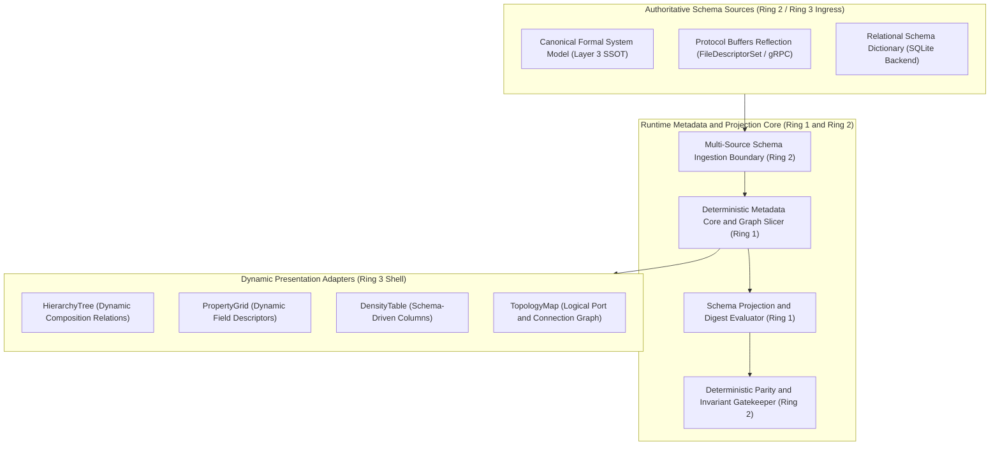

# DEAP Runtime Metadata Engine & Dynamic AST Projection Architecture Blueprint

> **Architecture Layer:** Layer 2 -- Downstream Target-Application Runtime Blueprint (exported via [Downstream Profile Export Manifest](../README.md), governed by upstream `DOCUMENT_AND_SPECIFICATION_STANDARD.md`)

| Attribute | Specification Detail |
| :--- | :--- |
| **Document Identifier** | `DEAP-BLUEPRINT-METADATA-001` |
| **Title** | Runtime Metadata Engine & Dynamic AST Projection Architecture Blueprint |
| **Version** | `2.1.0` |
| **Date** | `2026-11-12` |
| **Status** | `APPROVED / PRODUCTION-GRADE` |
| **Classification** | `DOWNSTREAM_PROFILE_TARGET_APP_RUNTIME` (`UPSTREAM_PLATFORM_TEMPLATE` & `DOWNSTREAM_CUSTOMER_PROJECT`) |
| **Assurance Level** | `AssuranceLevel::Tier1` (Zero Hardcoded Domain Logic & Dynamic Schema Discovery) |
| **Companion Downstream Profiles** | [PERSISTENCE_ARCHITECTURE_BLUEPRINT.md](./PERSISTENCE_ARCHITECTURE_BLUEPRINT.md), [SAFETY_CRITICAL_REALTIME_UI_BLUEPRINT.md](../profile-dart-flutter-hmi/SAFETY_CRITICAL_REALTIME_UI_BLUEPRINT.md), [DART_RUST_FFI_SYNTHESIS_PROFILE.md](../profile-dart-flutter-hmi/DART_RUST_FFI_SYNTHESIS_PROFILE.md), [DART_FLUTTER_CODING_STANDARD.md](../profile-dart-flutter-hmi/DART_FLUTTER_CODING_STANDARD.md) |
| **Upstream Governing Authority** | Upstream `DOCUMENT_AND_SPECIFICATION_STANDARD.md` (`ISO/IEC/IEEE 42010` Layer 2 Architecture Description) & `CANONICAL_AST_AND_IR_BLUEPRINT.md` |

---

## 1. Executive Summary & Pure Schema-Driven Invariant

The **DEAP Runtime Metadata Engine** (`DEAP-BLUEPRINT-METADATA-001` v2.1.0, Layer 2 System Architecture Blueprint exported in [Downstream Profile Export Manifest](../README.md) and aligned with upstream `DOCUMENT_AND_SPECIFICATION_STANDARD.md`, `CANONICAL_AST_AND_IR_BLUEPRINT.md`, and `INGEST_SYSML_BLUEPRINT.md`) eliminates hardcoded domain classes, static layout assumptions, and compile-time domain data structures across both schema ingestion pipelines and client presentation tiers. In strict adherence to the **Pure Schema-Driven Architecture Invariant**:
- The application engine and UI adapters possess ZERO hardcoded domain concepts at compile time.
- All entity types, structural fields, relations, visual symbols, validation invariants, and section hierarchies are discovered dynamically at runtime from connected authoritative data sources and canonical Layer 3 formal system models.
- All system models are expressed via purely symbolic computer science primitives: `PartDef_Alpha`, `Subsystem_01`, `Port_A`, `Action_01`, `Constraint_Invariant`.
- Static layout files with hardcoded field enumerations are prohibited; schemas are ingested dynamically from canonical formal system models, Protocol Buffers descriptor reflection (`FileDescriptorSet`), and relational schema dictionaries through a unified schema discovery boundary.

---

## 2. Three-Ring Assurance Containment & Conceptual Subsystem Architecture

The Runtime Metadata Engine partitions its conceptual capabilities across the three concentric assurance rings defined in upstream `DOCUMENT_AND_SPECIFICATION_STANDARD.md` and [DART_RUST_FFI_SYNTHESIS_PROFILE.md](../profile-dart-flutter-hmi/DART_RUST_FFI_SYNTHESIS_PROFILE.md) so that untrusted external schemas and host presentation workflows never compromise deterministic core metadata invariants.

### 2.1 Conceptual Subsystem & Assurance Ring Partitioning

Each conceptual subsystem operates within an explicit assurance ring boundary with deterministic, grammar-driven schema handling and zero ad-hoc character or line scanners:

| Conceptual Subsystem | Assurance Ring | Architectural Responsibility in Metadata Discovery & Projection |
| :--- | :--- | :--- |
| **Canonical Metadata & Graph Core** | `Ring 1` (Deterministic Certified Core) | Defines the pure, deterministic metadata graph metamodel, canonical entity/field/relation descriptors, invariant constraint predicates, and bounded-token subgraph slicing with zero ambient host I/O or hardcoded domain concepts. |
| **Schema Projection & Digest Engine** | `Ring 1` / `Ring 2` | Evaluates canonical Layer 3 system models, computes atomic cryptographic `SHA-256` schema digests, projects hazard and traceability views, and synthesizes deterministic boundary contracts across `Ring 2` isolation guards. |
| **Architectural Parity & Invariant Gatekeeper** | `Ring 2` (Audited Adaptation Boundary) | Enforces deterministic structural parity, schema cleanliness, traceability completeness, and 3-Ring containment invariants under the qualified toolchain pinned in `criticalup.toml`. |
| **Multi-Source Schema Ingestion Boundary** | `Ring 2` (Audited Adaptation Boundary) | Discovers, sanitizes, and translates structured external specifications, binary descriptor sets, and formal models into canonical metadata graphs through lossless grammar-driven frontends with zero hand-rolled scanners. |
| **Operational Concept Projection Subsystem** | `Ring 3` (Host Orchestration Shell) | Projects hierarchical operational concepts and mission-intent specification views from validated schema metadata without mutating `Ring 1` certified core state. |
| **Planning & Backlog Reconciliation Subsystem** | `Ring 3` (Host Orchestration Shell) | Synchronizes architectural epic, feature, user-story, use-case, and work-breakdown metadata registers with external planning trackers outside the safety-critical execution ring. |

---

## 3. Core AST Models & Runtime Metadata Projection Contracts

### 3.1 Canonical Structural & Behavioral Metadata Entities (Ring 1 Core)

The authoritative structural and behavioral metadata projected from canonical Layer 3 formal system models is represented inside the `Ring 1` certified core by deterministic metadata entity contracts:

| Conceptual Metadata Entity | Structural Role | Conceptual Properties | Ingress Preconditions | Projection Postconditions | 3-Ring Assurance Containment |
| :--- | :--- | :--- | :--- | :--- | :--- |
| `AttributeMetadata` | Property Metadata Node | Identifier `name`, resolved `type_ref`, optional `multiplicity` bounds, optional `default_value` literal | Extracted from a validated formal model property declaration | Preserves property identifier, resolved conceptual type reference, cardinality bounds, and optional default literal | `Ring 1` Deterministic Certified Core (zero dynamic heap allocation during core invariant evaluation) |
| `PortMetadata` | Boundary Interaction Node | Identifier `name`, flow `direction` (`in`, `out`, `inout`), `conjugated` polarity flag, logical interface `type_ref` | Extracted from a validated formal boundary port declaration | Preserves port flow directionality, conjugation state, and logical interface reference | `Ring 1` Deterministic Certified Core (zero dynamic heap allocation during core invariant evaluation) |
| `ComponentMetadata` | Composite Classifier Node | Stable `id`, qualified `name`, ordered `attributes`, ordered `ports`, ordered invariant `constraints` | Extracted from a validated structural component classifier | Produces a canonical deterministic metadata graph node for bounded slicing and downstream view projection | `Ring 1` Deterministic Certified Core (zero dynamic heap allocation during core invariant evaluation) |

### 3.2 Dynamic UI Projection Descriptors & DataSource Contract

Downstream `Ring 3` presentation shells receive `TypeDescriptor` and `FieldDescriptor` projections derived deterministically from `Ring 1` package and `ComponentMetadata` nodes without hardcoded domain classes:

| Projection Descriptor | Architectural Role | Conceptual Properties | Projection Preconditions | Projection Postconditions | 3-Ring Assurance Containment |
| :--- | :--- | :--- | :--- | :--- | :--- |
| `TypeDescriptor` | Entity View Schema | Stable `id`, display `label`, `icon_symbol`, lexicographically ordered `fields`, lexicographically ordered `relations` | Projected from a resolved `ComponentMetadata` node in the canonical metadata graph | Produces a deterministic, total-order schema descriptor for generic presentation rendering | `Ring 1` Deterministic Certified Core projection exported read-only across `Ring 2` |
| `FieldDescriptor` | Property Form & Column Schema | Field `name`, closed `field_type` classification, `required` flag, `section_label`, `section_order`, ordered validation `constraints` | Projected from an `AttributeMetadata` child of the owning `ComponentMetadata` node | Binds deterministic presentation control classification, mandatory-input state, and boundary validation predicates | `Ring 1` Deterministic Certified Core projection exported read-only across `Ring 2` |
| `FieldType` | Closed Widget Domain Taxonomy | Exhaustive variants: `Text`, `Number`, `Boolean`, `DateTime`, `Enum` (ordered option set), and `Reference` (`target_type_id`) | Mapped deterministically from canonical scalar, enumeration, or composition reference metadata | Guarantees exhaustive, closed-set widget selection with zero unmapped fallback strings | `Ring 1` Deterministic Certified Core closed classification |
| `TypeRelationDescriptor` | Directed Graph Edge Schema | Relation `name`, `target_type_id`, multiplicity `cardinality`, `display_label` | Projected from a `PortMetadata` or composition link on the owning `ComponentMetadata` node | Preserves target classifier identity and cardinality bounds for hierarchy and topology rendering | `Ring 1` Deterministic Certified Core projection exported read-only across `Ring 2` |

### 3.3 Pluggable Data Source Boundary Contract

| Boundary Contract | Architectural Role | Operations & Structured Variants | Boundary Preconditions | Boundary Postconditions | 3-Ring Assurance Containment |
| :--- | :--- | :--- | :--- | :--- | :--- |
| `DataSourceError` | Closed Boundary Failure Taxonomy | Structured variants: `UnknownType`, `UnknownInstance`, `InvalidPayload`, and `StorageFailure` carrying typed context identifiers | Emitted upon schema validation failure, unknown entity/instance lookup, or persistence fault | Reports deterministic, closed-enumeration failure diagnostics across `Ring 2` without unstructured raw exceptions | `Ring 1` / `Ring 2` deterministic boundary error contract |
| `DataSource` | Pluggable Query & Mutation Port | `listTypes`, `getType`, `queryInstances`, `putInstance`, and `deleteInstance` mediating typed instance access | Registered `TypeDescriptor` catalog and validated ASCII/UTF-8 entity and instance identifiers | Enforces dynamic schema validation against `FieldDescriptor` bounds and invariants in `Ring 2` prior to `Ring 3` state mutation | `Ring 2` validation gate mediating `Ring 3` persistence adapters |

---

## 4. Strongly-Typed AST Slicing Mechanics ($\le 4,096$ Tokens)

To enable context-isolated subagent reasoning and bounded-footprint client data synchronization, the `Ring 1` Runtime Metadata Engine projects localized subtrees from the canonical metadata graph through a deterministic **AST Slicing Window**:

### 4.1 Token Budget Invariant

For any target subsystem or component model $v_0$:

$$
\begin{aligned}
\mathcal{V}_ {\text{slice}} = \{v_0\} \cup \mathcal{N}_ {\text{child}}(v_0) \cup \mathcal{N}_ {\text{port}}(v_0) \cup \mathcal{N}_ {\text{conn}}(v_0)
\end{aligned}
$$

The serialized token footprint satisfies:

$$
\begin{aligned}
|\text{TokenCount}(\text{Serialize}(\mathcal{S}(v_0)))| \le 4096
\end{aligned}
$$

Any peripheral nodes exceeding the 4,096 token boundary are stubbed as opaque interface signatures (`ExternalInterfaceRef { id, port_signature }`), preventing context window overflow during LLM code synthesis.

---

## 5. Multi-Source Pluggable Data Source Engine

The Runtime Metadata Engine supports three canonical schema discovery modalities operating without compile-time domain classes across formal system models, structured interface specifications, and relational schema dictionaries using lossless grammar-driven frontends with **zero hand-rolled scanners**.

### 5.1 Relational Schema Dictionary (SQLite Backend)

| Dictionary Entity | Architectural Role | Conceptual Attributes | Domain Invariant | 3-Ring Containment & Integrity Guarantee | Architectural Requirement |
| :--- | :--- | :--- | :--- | :--- | :--- |
| `TypeDefinitionRecord` | Entity Type Catalog Entry | Non-empty text identifiers `type_name`, `display_name`, and `icon_symbol` | `type_name`, `display_name`, and `icon_symbol` each have strictly positive character length | `Ring 3` host schema dictionary with primary-key uniqueness on `type_name` | `REQ-META-SQL-001` |
| `TypeAttributeRecord` | Field Schema & Constraint Entry | Non-negative `id`, `type_name`, `key`, `label`, `field_type`, optional `section_label`, non-negative `section_order`, boolean `is_required`, optional numeric bounds (`min_value`, `max_value`), optional `validation_rule_id`, `enum_options`, `default_value`, and `input_formatters` | `id >= 0`, `section_order >= 0`, `min_value <= max_value` whenever both bounds are present, and non-empty `type_name` and `key` | `Ring 3` foreign-key referential integrity bound to `TypeDefinitionRecord.type_name` | `REQ-META-SQL-001` |
| `TypeRelationRecord` | Directed Composition & Link Entry | Non-negative `id`, `parent_type`, `relation_name`, `child_type`, and `display_label` | `id >= 0` and strictly non-empty `parent_type`, `relation_name`, and `child_type` | `Ring 3` parent and child referential integrity bound to `TypeDefinitionRecord.type_name` | `REQ-META-SQL-001` |

### 5.2 Protocol Buffers Reflection Adapter (gRPC Backend)
- Ingests binary Protocol Buffers descriptor sets (`FileDescriptorSet`) across the `Ring 2` ingestion boundary and discovers message and service definitions dynamically without static domain stubs.
- Custom proto annotations map field constraints (`min_value`, `max_value`, `validation_rule_id`) directly into `FieldDescriptor` properties without generating static target code.

### 5.3 Canonical Formal Model Adapter (Ring 1 & Ring 2 Projection)
- Ingests canonical Layer 3 formal system model graphs and verifies cryptographic `SHA-256` schema digest integrity at the `Ring 2` boundary prior to runtime metadata projection.
- Projects `ComponentMetadata`, `PortMetadata`, behavioral action, and formal constraint metadata nodes directly into the runtime `TypeDescriptor` registry.

### 5.4 Three-Ring Boundary Marshaling & Typed Instance View Projection
To resolve the tension between dynamic SQLite metadata discovery and compile-time type safety:
- **Deterministic Relational Seed & Typed View Projection**: Schema projection deterministically populates the five canonical relational metadata and instance tables (`type_definitions`, `type_attributes`, `type_relations`, `properties`, and `instances`) from validated formal model state while projecting strongly-typed `InstanceRecord` view contracts for `Ring 3` presentation adapters, coordinated with [SAFETY_CRITICAL_REALTIME_UI_BLUEPRINT.md](../profile-dart-flutter-hmi/SAFETY_CRITICAL_REALTIME_UI_BLUEPRINT.md).
- **Zero-Trust Ring 2 Isolation & Binary Marshaling Boundary**: An audited Minimal Trusted Computing Base (MTCB) `Ring 2` boundary mediates fixed-envelope byte-buffer transfers between `Ring 3` presentation or persistence shells and deterministic `Ring 1` certified core evaluators across 3-Ring assurance partitions, coordinated with [PERSISTENCE_ARCHITECTURE_BLUEPRINT.md](./PERSISTENCE_ARCHITECTURE_BLUEPRINT.md).
- **Toolchain Qualification & Cross-Platform Boundary Parity**: Downstream verification enforces schema-to-projection parity, memory safety, bounded model checking, and 3-Ring isolation invariants under the qualified toolchain lock pinned in root `criticalup.toml` across supported workstation operating systems.

---

## 6. Reactive Telemetry & State Binding Architecture

To prevent high-frequency telemetry event storms from freezing user interfaces or saturating execution pipelines:

1. **Background Execution Decoupling**: Raw binary telemetry streams (gRPC/Protobuf) are unpacked and schema-validated entirely inside isolated `Ring 3` background worker contexts decoupled from the primary presentation frame loop.
2. **Coherent Micro-Batching Window ($0.100\text{ s}$)**: Telemetry updates are accumulated over a fixed $0.100\text{ s}$ ($10\text{ Hz}$) sliding window, deduplicated by entity-attribute key (retaining the latest sample), and dispatched as a bounded flat state delta.
3. **Event-Echo Elimination**: Programmatic property updates applied by incoming telemetry streams NEVER trigger UI output callbacks (`onChange`, `onSave`). Event emission is strictly locked to direct operator input.

---

## 7. Architectural Gap Remediation Matrix

| Legacy Anti-Pattern | Runtime Metadata Engine Remediation |
| :--- | :--- |
| Hardcoded target-language domain classes (`SubsystemA`, `PartModelB`) | Generic presentation adapters rendering `TypeDescriptor` collections projected dynamically from canonical `ComponentMetadata` nodes. |
| Hardcoded `switch(node.id)` statements for icon mapping | Dynamic `TypeDescriptor.icon_symbol` resolution. |
| Hardcoded UI layout groupings in views | Declarative `FieldDescriptor.section_label` and `section_order`. |
| Hardcoded validation logic per field key | Declarative boundaries (`min_value`, `max_value`, `validation_rule_id`, `required`) derived from formal constraint metadata. |
| In-memory ephemeral configuration | Zero-ephemeral storage: all authoritative metadata definitions reside in Layer 3 formal system models (`schema/*.sysml`) guarded by cryptographic `SHA-256` schema digests. |
| Hardcoded enum string maps | Dynamic `FieldDescriptor.enum_options` sets derived from formal enumeration and state-machine metadata. |

---

## 8. Verification & Conformance Strategy

- **Architectural & Schema Parity Verification**: Automated parity gates verify deterministic structural correspondence across Layer 3 formal system models, `Ring 1` `TypeDescriptor` and `FieldDescriptor` projections, and `Ring 3` relational dictionary records with zero hardcoded domain assumptions.
- **Qualified Toolchain & 3-Ring Assurance Verification**: Downstream Layer 5 verification suites execute under the qualified toolchain pinned in root `criticalup.toml`, validating `Ring 1` deterministic core invariants, `Ring 2` marshaling bounds, and `Ring 3` state isolation in conformance with upstream `DOCUMENT_AND_SPECIFICATION_STANDARD.md`, upstream `RUST_CODING_STANDARD.md`, and [DART_FLUTTER_CODING_STANDARD.md](../profile-dart-flutter-hmi/DART_FLUTTER_CODING_STANDARD.md).
- **Zero Em Dash Invariant**: The document contains 0 Unicode em dashes (`\u2014`), using ASCII `--` or `-` exclusively.
- **Zero Prohibited Terms**: Contains 0 kinetic, munition, or regulatory agency citations.

---

## 9. Governance & Document Sign-Off

| Role | Domain Authority | Status | Verification Signature |
| :--- | :--- | :--- | :--- |
| **Systems Architecture Lead** | Dynamic Model Metamodel | APPROVED | `Arch. System, PE` |
| **Compiler Engine Lead** | Metadata Slicing & Schema Projection | APPROVED | `Lead. Compiler, SE` |
| **Forensic Quality Auditor** | Purity & Schema Invariants | APPROVED | `Audit. Teamwork, QA` |
